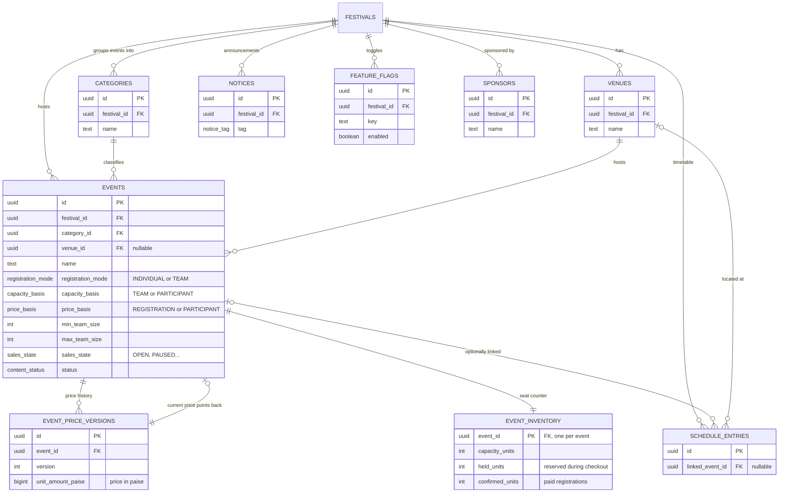

# Database ER Diagram (Beginner's Guide)

This document explains the database used by this project (a **Supabase / PostgreSQL** database) using Entity-Relationship (ER) diagrams.

## How to read these diagrams

An ER diagram shows **tables** (boxes) and the **relationships** between them (lines).

The symbols at the ends of each line mean:

| Symbol | Meaning | Plain English |
|--------|---------|---------------|
| `||` | Exactly one | There must be one matching row |
| `o\|` | Zero or one | There can be at most one matching row |
| `}o` | Zero or many | A row can link to any number of rows |
| `}\|` | One or many | At least one row must exist |

So `FESTIVALS ||--o{ EVENTS : "has"` reads:

> "One **festival** has zero-or-many **events**, and each **event** belongs to exactly one **festival**."

In SQL this is always implemented with a **foreign key**: `events.festival_id` points at `festivals.id`.

Column markers inside boxes:

- **PK** = Primary Key (unique identifier of the row)
- **FK** = Foreign Key (points to another table's PK)
- **UQ** = Unique (no duplicates allowed)

> **Note:** `auth.users` is Supabase's built-in authentication table. It stores accounts/logins. Our own `profiles` table extends it 1-to-1 with extra info (name, college, phone). It is not defined in our migrations because Supabase manages it for us.

---

## 1. Identity & Access Control (who can do what)

```mermaid
erDiagram
    auth_users ||--|| PROFILES : "has extra info"
    FESTIVALS ||--o{ ROLES : "defines"
    ROLES ||--o{ ROLE_PERMISSIONS : "grants"
    PERMISSIONS ||--o{ ROLE_PERMISSIONS : "listed in"
    FESTIVALS ||--o{ STAFF_ASSIGNMENTS : "staffed by"
    auth_users ||--o{ STAFF_ASSIGNMENTS : "works as"
    ROLES ||--o{ STAFF_ASSIGNMENTS : "assigned via"
    STAFF_ASSIGNMENTS ||--o{ STAFF_EVENT_SCOPES : "limited to events"

    auth_users {
        uuid id PK
        citext email
    }
    PROFILES {
        uuid user_id PK "FK -> auth.users.id"
        text display_name
        text college_name
        text phone_e164
        text public_member_code UQ
        profile_status status
    }
    FESTIVALS {
        uuid id PK
        text slug UQ
        smallint year
        festival_status status
    }
    ROLES {
        uuid id PK
        uuid festival_id FK
        text name
        boolean is_superadmin
    }
    PERMISSIONS {
        uuid id PK
        text code UQ
    }
    ROLE_PERMISSIONS {
        uuid role_id PK "FK"
        uuid permission_id PK "FK"
    }
    STAFF_ASSIGNMENTS {
        uuid id PK
        uuid festival_id FK
        uuid user_id FK
        uuid role_id FK
        staff_assignment_status status
    }
    STAFF_EVENT_SCOPES {
        uuid staff_assignment_id PK "FK"
        uuid event_id PK
    }
```

**Story:** Every person who signs up gets a `profiles` row automatically (via a database trigger). Organisers define `roles` per festival (e.g. "Scanner Operator"). Roles are bundles of `permissions` (`role_permissions` joins them). A user is given a role through a `staff_assignments` row, optionally restricted to specific `events` (`staff_event_scopes`). Every sensitive action is written to the append-only `audit_logs`.

Other tables in this group: `audit_logs` (who did what, when), `support_questions` (visitor questions tied loosely to users).

---

## 2. Content Catalog (what is happening at the fest)



**Story:** A festival has categories ("Tech", "Cultural") and venues. Events belong to a category and optionally a venue. Prices are never edited in place — every price change creates a new immutable `event_price_versions` row and `events.current_price_version_id` points to the live one (so old orders keep the price they were sold at). `event_inventory` is the authoritative seat counter: `capacity = held + confirmed + free`.

Passes work the same way: `pass_products` → `pass_price_versions` (same versioning pattern), both scoped to a festival.

---

## 3. Checkout: Teams & Orders (buying things)

```mermaid
erDiagram
    auth_users ||--o{ TEAM_DRAFTS : "is captain of"
    EVENTS ||--o{ TEAM_DRAFTS : "formed for"
    TEAM_DRAFTS ||--o{ TEAM_DRAFT_MEMBERS : "recruits"
    auth_users ||--o{ TEAM_DRAFT_MEMBERS : "joins as"
    FESTIVALS ||--o{ ORDERS : "placed at"
    auth_users ||--o{ ORDERS : "purchases"
    ORDERS ||--o{ ORDER_LINES : "contains"
    PASS_PRODUCTS |o--o{ ORDER_LINES : "PASS line"
    EVENTS |o--o{ ORDER_LINES : "EVENT line"
    ORDER_LINES ||--o{ ORDER_PARTICIPANTS : "who is covered"
    auth_users ||--o{ ORDER_PARTICIPANTS : "participates"
    DELEGATE_PASSES |o--o{ ORDER_PARTICIPANTS : "uses pass"
    ORDER_LINES ||--|| CAPACITY_HOLDS : "reserves seats via"
    EVENTS ||--o{ CAPACITY_HOLDS : "seats held from"
    ORDER_LINES ||--o{ EVENT_PARTICIPANT_CLAIMS : "claims per participant"
    EVENTS ||--o{ EVENT_PARTICIPANT_CLAIMS : "claimed at"

    TEAM_DRAFTS {
        uuid id PK
        uuid captain_user_id FK
        uuid event_id FK
        text team_name
        team_draft_status status "DRAFT..CONFIRMED"
    }
    TEAM_DRAFT_MEMBERS {
        uuid team_draft_id PK "FK"
        uuid user_id PK "FK"
        team_member_role role "CAPTAIN/MEMBER"
        team_member_status status "INVITED/ACCEPTED..."
    }
    ORDERS {
        uuid id PK
        text public_order_code UQ
        uuid purchaser_user_id FK
        order_kind kind "BASE_PASS or EVENT"
        checkout_state checkout_state "AWAITING_PAYMENT..FULFILLED"
        bigint amount_paise
        timestamptz hold_expires_at
    }
    ORDER_LINES {
        uuid id PK
        uuid order_id FK
        order_line_kind line_kind "PASS or EVENT"
        uuid pass_product_id FK "if PASS"
        uuid event_id FK "if EVENT"
        int charge_quantity
        bigint line_amount_paise
    }
    ORDER_PARTICIPANTS {
        uuid order_line_id PK "FK"
        uuid user_id PK "FK"
        participant_role role
    }
    CAPACITY_HOLDS {
        uuid id PK
        uuid order_line_id FK "unique, 1:1 with line"
        uuid event_id FK
        int units
        hold_state state
        timestamptz expires_at
    }
    EVENT_PARTICIPANT_CLAIMS {
        uuid id PK
        uuid event_id FK
        uuid user_id FK
        uuid order_line_id FK
        claim_state state "HELD/CONFIRMED/RELEASED"
    }
    API_IDEMPOTENCY {
        uuid id PK
        text scope
        uuid idempotency_key
        idempotency_state state
    }
```

**Story:** For team events, a captain creates a `team_drafts` row; members join via `team_draft_members` (accept/decline). Checkout then:

1. Creates an `orders` row (kind `BASE_PASS` or `EVENT`).
2. Adds an `order_lines` row snapshotting the exact price version.
3. For events: reserves seats by bumping `held_units` in `event_inventory`, writes one `capacity_holds` row (10-minute timer) and one `event_participant_claims` row per member.
4. If payment never arrives, `capacity_holds` expire → inventory is released and claims go to `RELEASED`.

`api_idempotency` prevents double-clicks from creating duplicate orders (same request replayed returns the same order).

---

## 4. Payments & Refunds

```mermaid
erDiagram
    ORDERS ||--o| RAZORPAY_ORDERS : "mapped to provider"
    ORDERS |o--o{ PAYMENTS : "paid by"
    ORDERS ||--o| PAYMENT_APPLICATIONS : "fulfilled once"
    PAYMENTS ||--o| PAYMENT_APPLICATIONS : "applied to"
    PAYMENTS ||--o{ REFUNDS : "money returned"
    REFUNDS ||--o{ REFUND_ALLOCATIONS : "split across lines"
    ORDER_LINES ||--o{ REFUND_ALLOCATIONS : "absorbs refund"

    RAZORPAY_ORDERS {
        uuid id PK
        uuid local_order_id FK "UQ - our order"
        text razorpay_order_id UQ
        bigint expected_amount_paise
    }
    PAYMENTS {
        uuid id PK
        text razorpay_payment_id UQ
        uuid local_order_id FK "nullable until matched"
        bigint amount_paise
        payment_disposition disposition "UNAPPLIED/APPLIED/REFUND_REQUIRED"
    }
    PAYMENT_APPLICATIONS {
        uuid order_id PK "FK"
        uuid payment_id PK "FK"
        bigint amount_paise
    }
    REFUNDS {
        uuid id PK
        uuid payment_id FK
        bigint amount_paise
        refund_state state
        text razorpay_refund_id UQ
    }
    REFUND_ALLOCATIONS {
        uuid refund_id PK "FK"
        uuid order_line_id PK "FK"
        bigint amount_paise
    }
    WEBHOOK_EVENTS {
        uuid id PK
        webhook_provider provider
        processing_state processing_state
    }
```

**Story:** We never trust the browser with amounts. When Razorpay calls us (webhook) or the browser confirms, `apply_captured_payment()` runs: it verifies amount/currency match, applies the payment **at most once** (`payment_applications` enforces that), converts holds into confirmed inventory, creates `registrations`/`delegate_passes`, and marks the order `FULFILLED`. Mismatches set disposition to `REVIEW` / `REFUND_REQUIRED`. `webhook_events` stores raw provider payloads so retries are safe (idempotent).

---

## 5. Fulfilment: Passes & Registrations

```mermaid
erDiagram
    PASS_PRODUCTS ||--o{ PASS_PRICE_VERSIONS : "price history"
    FESTIVALS ||--o{ PASS_PRODUCTS : "sells"
    ORDER_LINES ||--|| DELEGATE_PASSES : "purchase produces"
    auth_users ||--o{ DELEGATE_PASSES : "owns"
    ORDER_LINES ||--|| REGISTRATIONS : "purchase produces"
    EVENTS ||--o{ REGISTRATIONS : "registered for"
    auth_users ||--o{ REGISTRATIONS : "owns"
    REGISTRATIONS ||--o{ REGISTRATION_MEMBERS : "roster"
    auth_users ||--o{ REGISTRATION_MEMBERS : "member"
    DELEGATE_PASSES |o--o{ REGISTRATION_MEMBERS : "covered by pass"

    DELEGATE_PASSES {
        uuid id PK
        text public_pass_code UQ
        uuid user_id FK
        uuid pass_product_id FK
        uuid source_order_line_id FK "UQ"
        pass_state state "ACTIVE/REVOKED/REFUNDED"
        timestamptz expires_at
    }
    REGISTRATIONS {
        uuid id PK
        text public_registration_code UQ
        uuid order_line_id FK "UQ, 1:1 with line"
        uuid event_id FK
        uuid owner_user_id FK
        text team_name
        registration_state state
    }
    REGISTRATION_MEMBERS {
        uuid registration_id PK "FK"
        uuid user_id PK "FK"
        uuid delegate_pass_id FK "nullable"
        participant_role role
    }
```

**Story:** After successful payment:
- A **base/delegate pass** purchase creates one `delegate_passes` row per product tier (one active per user+festival+product).
- An **event** purchase creates one `registrations` row plus one `registration_members` row per participant.

---

## 6. QR Codes & Gate Scanning

```mermaid
erDiagram
    DELEGATE_PASSES ||--|| QR_CREDENTIALS : "signed as QR"
    FESTIVALS ||--o{ GATES : "entry points"
    EVENTS |o--o{ GATES : "event-specific gate"
    SCANNER_DEVICES ||--o{ GATE_ASSIGNMENTS : "assigned to"
    GATES ||--o{ GATE_ASSIGNMENTS : "at"
    auth_users ||--o{ GATE_ASSIGNMENTS : "operated by"
    QR_CREDENTIALS ||--o{ SCAN_ATTEMPTS : "scanned"
    SCANNER_DEVICES |o--o{ SCAN_ATTEMPTS : "scanned by"
    GATES ||--o{ SCAN_ATTEMPTS : "scanned at"
    QR_CREDENTIALS ||--o{ ADMISSIONS : "admitted"
    GATES ||--o{ ADMISSIONS : "through"
    SCAN_ATTEMPTS ||--|| ADMISSIONS : "first accepted scan"

    QR_CREDENTIALS {
        uuid id PK
        uuid jti UQ "token ID inside JWT"
        uuid delegate_pass_id FK "UQ, 1:1 with pass"
        qr_credential_state state
    }
    GATES {
        uuid id PK
        uuid festival_id FK
        gate_type gate_type "GENERAL/EVENT/PRO_SHOW"
        admission_policy admission_policy "ONE_PER_DAY etc"
        uuid linked_event_id FK "nullable"
    }
    SCANNER_DEVICES {
        uuid id PK
        text public_device_id UQ
        scanner_device_state state
    }
    GATE_ASSIGNMENTS {
        uuid device_id FK
        uuid gate_id FK
        uuid operator_user_id FK
        timestamptz valid_until
    }
    SCAN_ATTEMPTS {
        uuid scan_id UQ "idempotency key"
        uuid credential_id FK
        uuid gate_id FK
        text outcome "accepted/duplicate/expired..."
    }
    ADMISSIONS {
        uuid credential_id FK
        uuid gate_id FK
        text scope_key "day or event"
        uuid first_scan_attempt_id FK
    }
```

**Story:** Each active `delegate_passes` row gets one signed JWT-based `qr_credentials` record. Scanners are registered devices; `gate_assignments` says which operator+device may scan which gate and when. Every tap appends an immutable `scan_attempts` row (even failures). Accepted scans create an `admissions` row — its unique index `(credential_id, scope_key)` blocks double entry under `ONE_PER_DAY` / `ONE_PER_EVENT` policies while allowing re-entry where configured.

---

## 7. Background Jobs (email, exports, sync)

```mermaid
erDiagram
    EMAIL_JOBS ||--o{ EMAIL_EVENTS : "delivery updates"
    auth_users |o--o{ EMAIL_JOBS : "recipient"
    FESTIVALS ||--o{ EXPORT_JOBS : "requested for"
    auth_users ||--o{ EXPORT_JOBS : "requested by"
    FESTIVALS ||--|| SHEETS_SYNC_STATE : "one sync config"
    FESTIVALS ||--o{ SHEETS_SYNC_ITEMS : "pending changes"

    OUTBOX_JOBS {
        uuid id PK
        text logical_key UQ "dedupe key"
        outbox_job_state state
        int attempts
    }
    EMAIL_JOBS {
        uuid id PK
        text logical_key UQ
        citext to_email_snapshot
        email_job_state state
    }
    EMAIL_EVENTS {
        uuid email_job_id FK
        text resend_event_id
        text event_type
    }
    EMAIL_SUPPRESSIONS {
        citext email PK
        text reason
    }
    EXPORT_JOBS {
        uuid id PK
        text export_type
        export_job_state state
    }
    WORKER_HEARTBEATS {
        text worker_name PK
        timestamptz last_success_at
    }
```

**Story:** Instead of sending emails directly during checkout (risky — could fail after payment), the system inserts `outbox_jobs` rows **in the same transaction** as the business change. Background workers claim jobs safely with `FOR UPDATE SKIP LOCKED`, send emails via Resend (`email_jobs` tracks delivery, `email_events` records provider callbacks, bounced addresses land in `email_suppressions`) or export spreadsheets (`export_jobs`, mirrored to Google Sheets via `sheets_sync_*`). `worker_heartbeats` proves the workers are alive.

---

## Big-picture flow (one sentence each)

1. Admin publishes **festivals → events/passes** with immutable price versions.
2. Student buys a **delegate pass** (or basic card) → `orders` → payment captured → `delegate_passes`.
3. Captain forms a **team draft**, checks out an event → seats *held* in `event_inventory` for 10 min.
4. Payment captured → holds consumed → `registrations` + `registration_members` created.
5. Delegate passes get signed **QR credentials**; gates scan them, appending `scan_attempts` and admitting once per policy scope.
6. Everything async (emails, exports, refunds submission) flows through **outbox/email job tables** processed by background workers.
