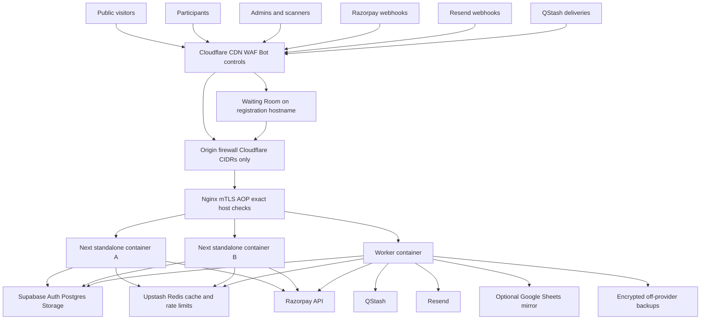

# PULSE Fest Platform — Production Implementation Plan

> **Document purpose:** This is the implementation contract for the remaining PULSE fest platform. An implementation LLM or developer should be able to write the code by following this document without redesigning any critical system behavior.
>
> **Project:** PULSE 2026 college fest website
>
> **Repository state reviewed:** Next.js `16.3.1`, React `19.2.8`, TypeScript, Tailwind CSS v4, pnpm. The existing repository is a frontend-only UI with mock data in `src/lib/data.ts`.
>
> **Plan reviewed against current provider documentation:** 2026-08-21.
>
> **Priority language:** `MUST` and `MUST NOT` are non-negotiable correctness or security requirements. `SHOULD` is a strong default. `MAY` is optional.

---

## 0. How the implementing LLM must use this document

1. Implement phases in order. Do not begin payment code before Phase 1 acceptance criteria pass.
2. Do not change a decision marked **LOCKED** unless the project owner explicitly approves an Architecture Decision Record (ADR) describing the replacement, migration path, risks, and tests.
3. Keep each pull request small enough to test and roll back. Prefer one migration plus its repository/service/tests per pull request.
4. Never weaken a database constraint, RLS policy, signature check, idempotency guard, or audit trail merely to make an integration test pass.
5. Never use Redis, Google Sheets, client state, or Razorpay response data as the source of truth for price, entitlement, inventory, registration, or payment application.
6. Use database time (`clock_timestamp()` / `now()`) for all financial and hold deadlines. Browser and VPS clocks are display inputs only.
7. Every externally visible mutation must have:
   - Authentication where applicable.
   - Authorization in server/database code, not only UI hiding.
   - Schema validation.
   - Idempotency behavior.
   - An audit/event record where applicable.
   - A bounded timeout.
   - A documented retry outcome.
8. After every phase, run the exact validation listed for that phase and record results in the pull request.
9. Do not redesign the existing neo-brutalist UI. Preserve it and connect it to the backend.
10. Do not commit real secrets, production IDs, private keys, service-role keys, webhook secrets, database URLs, email addresses from real participants, or provider payloads containing PII.

### Status legend

- `[x]` complete before this plan.
- `[ ]` not implemented.
- `[BLOCKED]` cannot proceed until an external account, credential, policy, or owner decision exists.
- `P0` launch blocker.
- `P1` required before event day but not necessarily before internal preview.
- `P2` useful follow-up.

---

# 1. Executive summary

## 1.1 Product target

The platform must support:

- Approximately 10,000 unique visitors/registrants over the event window.
- Approximately 150,000–200,000 page interactions/clicks.
- Short bursts of 2,000–3,000 concurrently active users around registration windows, ticket drops, and schedule announcements.
- Approximately 250 admin-created events.
- Approximately 10,000 event registrations.
- A compulsory base delegate pass initially priced at ₹200 before a user can enroll in another paid/free event.
- Individual and team events with configurable price and capacity semantics.
- Dynamic event publication, pricing, capacity, schedule, and notices from an admin console.
- Razorpay payment processing with no client-controlled price.
- Resend transactional emails.
- Secure QR passes, scanner roles, admission history, and duplicate detection.
- CSV exports and an optional Google Sheets operational mirror.
- Supabase Pro for Auth/Postgres and Upstash for managed Redis/rate limiting/queues.
- Self-hosted Next.js behind Cloudflare and Nginx on Hostinger VPS infrastructure.

## 1.2 Reliability objective

The total volume is modest. The dangerous conditions are:

- A cold-cache burst reaching the origin.
- Hundreds of users contending for the final units of one event.
- Duplicate, delayed, or out-of-order payment callbacks/webhooks.
- A process crash between a provider call and a local database write.
- Connection exhaustion caused by unbounded application pools.
- A single VPS or provider outage.
- Human admin mistakes during the event.

The design therefore prioritizes **bounded admission, atomic database state transitions, immutable financial snapshots, idempotency, recovery jobs, and tested rollback** over clever distributed counters.

## 1.3 Delivery phases

| Phase | Scope | Status |
|---|---|---|
| Phase 0 | Existing public UI and neo-brutalist design system | `[x] COMPLETE` |
| Phase 1 | Supabase foundation, Auth, RBAC, admin panel, events/schedule/notices/support connected to backend, Redis read cache | `[ ]` |
| Phase 2 | Delegate pass and event checkout, Razorpay, atomic holds/capacity, refunds, exports, Sheets mirror, reconciliation | `[ ]` |
| Phase 3 | Resend, React Email templates, durable email queue and delivery webhooks | `[ ]` |
| Phase 4 | Signed QR credentials, participant dashboard, scanner app, scan history, anti-passback | `[ ]` |
| Phase 5 | Production deployment, Cloudflare/Nginx hardening, multi-origin readiness, monitoring, backups, CI/CD, load testing | `[ ]` |

Phase 5 infrastructure basics must exist in staging while Phases 1–4 are developed. “Phase 5” means final production hardening and go-live gates, not waiting until the end to create staging.

---

# 2. Locked architectural decisions

## 2.1 Source-of-truth decisions

1. **LOCKED — PostgreSQL is authoritative.** Supabase Postgres is the sole source of truth for content, catalog, prices, capacity, holds, orders, payments, registrations, refunds, passes, roles, jobs, and scans.
2. **LOCKED — Redis is not inventory.** Upstash Redis is a cache, rate limiter, coordination aid, and queue transport. Redis `DECR` MUST NOT be the authoritative seat/team allocation mechanism.
3. **LOCKED — Sheets is not a backup.** Google Sheets is an optional delayed operational projection. It never participates in checkout, gate decisions, payment application, or recovery truth.
4. **LOCKED — Razorpay is the provider ledger, not the application state machine.** Provider IDs/statuses are persisted, but local fulfillment remains an explicit idempotent transaction.
5. **LOCKED — Every money amount is a `bigint` integer in paise.** Never use floating point or a database decimal interpreted as rupees in application logic. Initial base pass amount is `20000` paise.

## 2.2 Framework and data-access decisions

1. **LOCKED — Use Supabase Auth, not NextAuth/Auth.js.** Do not run a second session/auth system.
2. **LOCKED — Do not introduce Prisma.** Use:
   - Supabase CLI SQL migrations as schema authority.
   - Generated Supabase TypeScript database types.
   - `@supabase/supabase-js` and `@supabase/ssr` for Auth, RLS-backed reads, and RPC calls.
   - PostgreSQL functions for critical multi-row transactions.
   - A very small direct/session-pooled SQL client only for dedicated workers if an operation cannot be expressed cleanly through one RPC.
3. Critical transactions MUST be implemented in version-controlled PostgreSQL functions. Do not emulate a transaction by making multiple unrelated PostgREST calls.
4. Critical browser mutations MUST go through same-origin Next.js Route Handlers. The browser MUST NOT receive the Supabase service-role key or call financial/admin tables directly.
5. Public read pages SHOULD be Server Components backed by typed repositories. Client components receive serializable data props instead of importing mutable production data from `src/lib/data.ts`.

## 2.3 Purchase and capacity decisions

1. **LOCKED — Base pass and event checkout are separate orders.** A base pass cannot be combined with an event in one Razorpay order.
2. **LOCKED — Phase 2 supports one event registration per checkout.** No multi-event cart in v1. The schema may support multiple lines later, but the API accepts exactly one event. This removes partial-fulfillment/refund ambiguity.
3. Every event participant, including every team member, MUST have an active base delegate pass before an event hold can be created.
4. Team registration is paid by the captain/purchaser, but eligibility and duplicate-event checks apply to every member.
5. Capacity has explicit units:
   - `TEAM`: one confirmed team consumes one capacity unit.
   - `PARTICIPANT`: a team consumes its member count; an individual consumes one.
6. Price has explicit units:
   - `REGISTRATION`: one fee for the whole individual/team registration.
   - `PARTICIPANT`: unit price multiplied by accepted team size.
7. Event structure (`registration_mode`, capacity basis, price basis, min/max team size) becomes immutable after the first live hold. Admins may still publish/unpublish, change price, increase capacity, and reduce capacity only to a safe value.
8. Holds last 10 minutes from the PostgreSQL commit that reserves inventory. Clients cannot extend a hold.
9. An existing hold keeps its immutable snapshotted price for its remaining lifetime. A new checkout sees the latest price version.
10. Capacity can never be decreased below `held_units + confirmed_units`.
11. **LOCKED — automatic Razorpay capture.** Fulfillment occurs only for a server-verified captured payment/order-paid state.
12. A browser “success” callback is a hint. It is not sufficient proof of fulfillment.
13. A captured late payment that cannot be fulfilled becomes an explicit refund obligation. It must never disappear into a generic failed state.

## 2.4 Async and notification decisions

1. **LOCKED — transactional Postgres outbox plus QStash.** Business transactions insert durable outbox/job rows in the same database transaction. QStash wakes workers and supplies retries/flow control, but PostgreSQL remains job truth.
2. QStash is at-least-once. Every worker handler MUST be idempotent.
3. Never use Next.js `after()`, an in-memory timer, a Redis list, or local disk as the only record of a durable email/payment/refund/export job.
4. Hold expiry requiring sub-minute precision runs in a dedicated worker loop every 5–15 seconds. A one-minute QStash schedule is the recovery trigger because QStash schedule resolution is one minute.
5. Email failure never rolls back a valid payment, pass, or registration.

## 2.5 QR decisions

1. **LOCKED — versioned Ed25519-signed credential with no PII.** The QR contains a random credential/pass identifier and scope metadata, not name, email, college, phone, amount, Razorpay ID, or sequential public registration number.
2. A QR is a bearer credential. A signature prevents forgery but not screenshot sharing. Online database state, anti-passback rules, optional identity checks, and revocation handle copying.
3. Online scans are authoritative and atomic in Postgres.
4. Offline scans can only be provisional. Paid/capacity-limited event gates fail closed offline unless a supervisor records an explicit override. General campus admission may use a declared fail-soft policy.

## 2.6 Deployment decisions

1. **LOCKED — standalone Docker, no PM2 inside Docker.** Use Next.js `output: "standalone"`, immutable OCI images, Docker Compose/systemd supervision, and Nginx. PM2 inside a container duplicates supervision and complicates memory/process ownership.
2. If Docker is rejected later, use systemd to supervise standalone `server.js`; PM2 is only a fallback for a non-container deployment.
3. Nginx is the only origin listener exposed to Cloudflare. Next.js binds to loopback/internal Docker networking.
4. A custom `X-Origin-Secret` header is defense-in-depth only. It is not sufficient origin protection because direct callers can spoof headers.
5. Origin protection MUST use Cloudflare Full (strict), Cloudflare IP-range firewall rules, exact host validation, and custom zone/per-hostname Authenticated Origin Pulls (mTLS).
6. A single KVM 2 is a host-level single point of failure. The event-critical target is two origins behind Cloudflare Load Balancing. If the owner chooses one VPS, that is an explicit accepted outage risk, not “100% uptime.”
7. Cloudflare Business Waiting Room is the selected fair queue for high-demand registration. Pro does not include Waiting Room. Without Business, deploy an edge Worker emergency gate, but document that it is load protection rather than fair FIFO queueing.
8. Supabase Pro does not imply sufficient database compute. Use **Large compute during the final event window** unless production-scale tests prove Medium has at least 30% headroom. Never assume Micro is adequate.
9. Verify the current Upstash SKU. A paid Redis plan is not the same as the current Prod Pack. Enable Prod Pack for the event window when Redis availability controls order admission.

## 2.7 Time, privacy, and public identifier decisions

1. Store timestamps as `timestamptz` in UTC. Display in `Asia/Kolkata`.
2. Generate internal IDs as UUIDs. Public pass/registration references are random, non-enumerable, and separate from internal IDs.
3. The current `/verify` mock pattern such as `PULSE-2027-0001` MUST NOT expose real participant PII through public enumeration.
4. Do not store card, CVV, UPI credential, bank account, or full payment-instrument data.
5. Do not collect medical information or identity-document images unless separately approved.

---

# 3. Target architecture



## 3.1 Request classes

| Class | Examples | Cloudflare | App cache | DB behavior |
|---|---|---|---|---|
| Immutable static | `/_next/static/*`, versioned assets | Long immutable edge cache | N/A | No DB |
| Public content | home, events, schedule, notices | Explicit approved cache rules | Shared Next/Redis cache | Read-only, short TTL |
| Near-real-time availability | event cards/count endpoint | Edge TTL 2–5 seconds at most | Redis TTL 5–10 seconds | DB authoritative on checkout |
| Auth/session | login callback, dashboard | Bypass cache | No shared response cache | Supabase Auth/RLS |
| Critical write | checkout, admin mutations, scan | WAF and rate limit; never edge cached | No response cache | One atomic DB function |
| Provider webhook | Razorpay/Resend | No browser challenge; body limit | No cache | Verify raw signature, durably insert |
| Worker callback | QStash | No browser challenge | No cache | Verify QStash signature, claim job |
| Health | liveness/readiness | `no-store` | Small local check cache | Bounded dependency checks |

## 3.2 Hostnames

Use distinct hostnames even if they route to the same origin:

- `www.<domain>` — public website.
- `register.<domain>` — login, dashboard, team setup, checkout; Cloudflare Waiting Room applies here.
- `admin.<domain>` — staff admin panel; stricter WAF, Access policy optional, no public indexing.
- `scan.<domain>` — installed/PWA scanner interface; staff/device authentication only.
- `hooks.<domain>` — Razorpay, Resend, and QStash endpoints; no Waiting Room or browser challenges.

All hostnames use proxied Cloudflare DNS. Nginx rejects every unknown `Host`/SNI.

---

# 4. Current codebase and Phase 0

## 4.1 Existing implementation

The repository currently contains:

- Next.js App Router public pages.
- Neo-brutalist components and Tailwind design tokens.
- Static `FestEvent`, `ScheduleItem`, and `Notice` data in `src/lib/data.ts`.
- `/events` client filtering over imported arrays.
- `/schedule` client tabs over imported arrays.
- `/notices` static rendering.
- Home-page featured events and notice previews.
- A simulated `/ask` form.
- A client-side mock `/verify` page.

## 4.2 Phase 0 checklist

- [x] Public visual design.
- [x] Responsive layout and primary navigation.
- [x] Events page UI.
- [x] Schedule page UI.
- [x] Notices page UI.
- [x] Home featured events/notices UI.
- [x] Ask form UI.
- [x] Verify page UI shell.
- [x] Neo-brutalist design system.
- [x] TypeScript and Tailwind base project.

## 4.3 Rules when connecting the UI

1. Preserve current route URLs and visual behavior.
2. Move mutable data types to `src/domain/*` or generated database types. `src/lib/data.ts` may retain genuinely static fest copy/categories temporarily but MUST stop being production truth for events, schedule, notices, and verification.
3. Convert `EventsExplorer` to accept `events` and `categories` props or fetch a typed public API. It MUST NOT import mutable production arrays.
4. Convert `ScheduleBoard` to accept schedule props.
5. Convert `NoticeCard` and `EventCard` types to domain read models rather than mock-only types.
6. Format money from `amount_paise`; never persist/display a mutable rupee number as financial truth.
7. Event card availability labels use explicit units: “12 team slots left” or “12 participant slots left.”
8. Keep empty/loading/error states that remain usable if Redis is unavailable or content is temporarily empty.

---

# 5. Target dependencies and repository structure

## 5.1 Dependencies

Add only when the phase needs them:

### Phase 1

- `@supabase/supabase-js`
- `@supabase/ssr`
- `zod`
- `@upstash/redis`
- `@upstash/ratelimit`
- A structured logger such as `pino`

### Phase 2

- Official `razorpay` Node SDK, pinned to a reviewed compatible version.
- `@upstash/qstash`
- `csv-stringify` or an equivalent streaming CSV writer.
- Google API client only if the optional Sheets mirror is enabled.

### Phase 3

- `resend`
- `@react-email/components`
- React Email local preview tooling as development dependency.

### Phase 4

- `jose` for Ed25519/JWS-compatible signing and verification, or Node `crypto` with an explicitly tested canonical format. Do not invent ad hoc JSON signing.
- `qrcode` for PNG/SVG generation.
- `@zxing/browser` for scanner fallback. Prefer native `BarcodeDetector` when supported and use ZXing otherwise.

### Testing/operations

- `vitest`
- React Testing Library
- Playwright
- `testcontainers` or a local Supabase CLI stack for integration tests
- `k6` scripts stored in the repository
- `eslint-plugin-security` only if it produces actionable signal; do not let noisy lint replace review.

## 5.2 Intended repository tree

```text
fest/
├── plan.md
├── Dockerfile
├── docker-compose.yml
├── next.config.ts
├── instrumentation.ts
├── cache-handlers/
│   ├── server-cache-handler.mjs
│   └── remote-use-cache-handler.mjs
├── emails/
│   ├── components/
│   ├── delegate-pass-confirmation.tsx
│   ├── event-registration-confirmation.tsx
│   ├── payment-received-processing.tsx
│   ├── refund-initiated.tsx
│   ├── refund-completed.tsx
│   └── admin-invite.tsx
├── infra/
│   ├── nginx/
│   │   ├── nginx.conf
│   │   ├── conf.d/pulse.conf
│   │   └── cloudflare-real-ip.conf
│   ├── systemd/pulse-compose.service
│   ├── scripts/
│   │   ├── deploy.sh
│   │   ├── rollback.sh
│   │   ├── backup-db.sh
│   │   ├── restore-drill.sh
│   │   └── update-cloudflare-cidrs.sh
│   └── monitoring/
├── load/
│   ├── public-burst.k6.ts
│   ├── checkout-burst.k6.ts
│   ├── hot-event-race.k6.ts
│   ├── scanner-burst.k6.ts
│   └── README.md
├── supabase/
│   ├── config.toml
│   ├── seed.sql
│   ├── migrations/
│   │   ├── 0001_extensions_and_enums.sql
│   │   ├── 0002_profiles_and_rbac.sql
│   │   ├── 0003_content_catalog.sql
│   │   ├── 0004_content_rls_and_functions.sql
│   │   ├── 0005_checkout_and_inventory.sql
│   │   ├── 0006_payments_refunds_webhooks.sql
│   │   ├── 0007_outbox_email_exports.sql
│   │   ├── 0008_qr_scanning.sql
│   │   └── 0009_indexes_and_retention.sql
│   └── tests/
│       ├── rls.sql
│       ├── inventory_concurrency.sql
│       └── payment_idempotency.sql
└── src/
    ├── app/
    │   ├── (public)/
    │   ├── (auth)/
    │   ├── dashboard/
    │   ├── admin/
    │   ├── scanner/
    │   ├── auth/callback/route.ts
    │   └── api/
    │       ├── public/
    │       ├── admin/
    │       ├── checkout/
    │       ├── teams/
    │       ├── webhooks/
    │       ├── jobs/
    │       ├── scanner/
    │       └── health/
    ├── components/
    ├── domain/
    │   ├── auth.ts
    │   ├── content.ts
    │   ├── catalog.ts
    │   ├── checkout.ts
    │   ├── payments.ts
    │   ├── email.ts
    │   └── scanning.ts
    ├── lib/
    │   ├── env.ts
    │   ├── logger.ts
    │   ├── request-context.ts
    │   ├── csrf.ts
    │   ├── money.ts
    │   ├── supabase/
    │   │   ├── browser.ts
    │   │   ├── server.ts
    │   │   ├── service-role.ts
    │   │   └── database.types.ts
    │   ├── redis/
    │   │   ├── client.ts
    │   │   ├── keys.ts
    │   │   ├── rate-limits.ts
    │   │   └── content-cache.ts
    │   ├── razorpay/
    │   ├── qstash/
    │   ├── resend/
    │   ├── qr/
    │   └── validation/
    ├── repositories/
    │   ├── public-content.ts
    │   ├── admin-content.ts
    │   ├── checkout.ts
    │   ├── payments.ts
    │   └── scans.ts
    ├── services/
    │   ├── authz.ts
    │   ├── content-service.ts
    │   ├── checkout-service.ts
    │   ├── payment-service.ts
    │   ├── refund-service.ts
    │   ├── email-service.ts
    │   ├── export-service.ts
    │   └── scan-service.ts
    └── workers/
        ├── main.ts
        ├── hold-reaper.ts
        ├── outbox-dispatcher.ts
        ├── payment-reconciler.ts
        └── export-worker.ts
```

Do not move all existing routes immediately just to match this tree. Introduce structure incrementally and preserve route behavior.

---

# 6. Environment and secrets contract

## 6.1 Environments

Maintain separate Supabase, Upstash, Razorpay, Resend, Cloudflare, and storage credentials for:

- Local development.
- Automated test.
- Staging.
- Production.

Test/staging MUST use Razorpay Test mode. Production keys must never exist in pull-request preview or developer `.env.local` unless explicitly issued for an approved operator.

## 6.2 Environment variables

Validate all variables at process startup with Zod. Public variables must use `NEXT_PUBLIC_`; everything else remains server-only.

```text
# Application
NODE_ENV
APP_ENV
APP_BASE_URL
PUBLIC_SITE_URL
REGISTRATION_SITE_URL
ADMIN_SITE_URL
SCANNER_SITE_URL
HOOKS_BASE_URL
APP_TIMEZONE=Asia/Kolkata
DEPLOYMENT_ID
NEXT_SERVER_ACTIONS_ENCRYPTION_KEY
LOG_LEVEL

# Supabase public/server
NEXT_PUBLIC_SUPABASE_URL
NEXT_PUBLIC_SUPABASE_PUBLISHABLE_KEY
SUPABASE_SERVICE_ROLE_KEY
SUPABASE_DB_SESSION_URL              # worker only, if direct SQL is used
SUPABASE_DB_DIRECT_URL               # migrations/backups only

# Upstash Redis
UPSTASH_REDIS_REST_URL
UPSTASH_REDIS_REST_TOKEN
UPSTASH_REDIS_READONLY_TOKEN         # where useful

# QStash
QSTASH_TOKEN
QSTASH_CURRENT_SIGNING_KEY
QSTASH_NEXT_SIGNING_KEY

# Razorpay
NEXT_PUBLIC_RAZORPAY_KEY_ID
RAZORPAY_KEY_ID
RAZORPAY_KEY_SECRET
RAZORPAY_WEBHOOK_SECRET_CURRENT
RAZORPAY_WEBHOOK_SECRET_PREVIOUS     # temporary during rotation

# Resend
RESEND_API_KEY
RESEND_WEBHOOK_SECRET
EMAIL_FROM
EMAIL_REPLY_TO

# QR signing
QR_SIGNING_KEY_ID
QR_ED25519_PRIVATE_KEY_BASE64
QR_ED25519_PUBLIC_KEY_BASE64

# Google Sheets optional
GOOGLE_SHEETS_ENABLED=false
GOOGLE_SERVICE_ACCOUNT_JSON_BASE64
GOOGLE_DRIVE_FOLDER_ID
GOOGLE_MASTER_SPREADSHEET_ID

# Cloudflare deployment/purge
CLOUDFLARE_API_TOKEN
CLOUDFLARE_ZONE_ID

# Backup destination
BACKUP_S3_ENDPOINT
BACKUP_S3_BUCKET
BACKUP_S3_ACCESS_KEY_ID
BACKUP_S3_SECRET_ACCESS_KEY
BACKUP_AGE_RECIPIENT

# Observability
SENTRY_DSN
SENTRY_AUTH_TOKEN
OTEL_EXPORTER_OTLP_ENDPOINT
OTEL_EXPORTER_OTLP_HEADERS
```

## 6.3 Secret rules

1. Production secrets live in a root-readable server env file or Docker secrets with mode `0600`, not in the image.
2. GitHub Actions uses environment-scoped secrets and manual production approval.
3. Service-role, Razorpay secret, Redis write token, QStash token, Resend key, DB URLs, and QR private key must be guarded by `server-only` imports.
4. Add a build test that searches `.next/static` and source maps for known secret prefixes.
5. Rotate provider secrets before launch and after every suspected exposure.
6. During Razorpay webhook secret rotation, retain the previous secret for the documented retry window.
7. QR private key rotation issues new credentials with a new `kid`; old public keys remain verifiable until their credentials expire or are revoked.

---

# 7. Database design

## 7.1 General rules

1. Use `uuid` primary keys generated with `gen_random_uuid()`.
2. Add `created_at timestamptz not null default now()` and `updated_at` where mutable.
3. Use `citext` only when case-insensitive uniqueness is required; otherwise normalize explicitly.
4. Every table accessed through Supabase APIs has RLS enabled, including tables intended to be server-only. Server-only tables have no client policy.
5. Never use a nullable boolean for state. Use explicit enums/state columns and constraints.
6. Use immutable snapshot columns on order lines; never derive historical totals from current event/pass prices.
7. Add foreign keys with deliberate delete behavior. Financial/audit records normally use `RESTRICT`, not cascading deletion.
8. Never hard-delete payments, fulfilled orders, passes, registrations, refunds, webhooks, audits, or scans. Use state and retention/anonymization jobs.
9. All public list queries include deterministic ordering and bounded limits.
10. All text accepted from admins/users has length constraints in both Zod and SQL.

## 7.2 Core festival and profile tables

### `festivals`

Purpose: support the current fest and future editions without mixing data.

Key columns:

- `id uuid pk`
- `slug text unique`
- `name text`
- `year smallint`
- `timezone text default 'Asia/Kolkata'`
- `starts_at`, `ends_at`
- `status`: `DRAFT | PUBLISHED | CLOSED | ARCHIVED`
- `base_currency char(3) default 'INR'`
- `settings jsonb` for non-critical display settings only
- `version integer not null default 1`

Constraints:

- `starts_at < ends_at`
- Unique `(name, year)` if appropriate.

### `profiles`

Purpose: application profile linked one-to-one to `auth.users`.

Key columns:

- `user_id uuid pk references auth.users(id) on delete restrict`
- `display_name text`
- `college_name text`
- `phone_e164 text nullable`
- `public_member_code text unique` — random, non-sequential team-invite lookup code
- `profile_completed_at`
- `consent_version text`
- `consented_at`
- `status`: `ACTIVE | SUSPENDED | ANONYMIZED`

Do not copy auth password/session data. Trigger profile creation from `auth.users`, but make the trigger failure-safe and minimal.

## 7.3 RBAC tables

### `roles`

- Festival-scoped or system role definition.
- `id`, `festival_id nullable`, `name`, `description`, `is_system`, `is_superadmin`, `version`.
- Unique role name within scope.

### `permissions`

Fixed code catalog. Seed at migration time. Example codes:

```text
admin.access
staff.manage
role.manage
content.event.read
content.event.write
content.event.publish
content.event.price.write
content.event.capacity.write
content.schedule.write
content.notice.write
support.read
support.resolve
registration.read
registration.export
finance.read
refund.create
refund.approve
payment.reconcile
scanner.use
scanner.supervise
scanner.device.manage
pass.revoke
pass.reissue
audit.read
feature_flag.write
```

### `role_permissions`

- `(role_id, permission_id)` primary key.

### `staff_assignments`

- `id`
- `festival_id`
- `user_id`
- `role_id`
- `status`: `INVITED | ACTIVE | SUSPENDED | REVOKED`
- `invited_by`, `activated_at`, `revoked_at`
- `authz_version integer`
- Unique one active assignment for the same user/role/festival.

### `staff_event_scopes`

Restricts an event manager to selected events.

- `staff_assignment_id`
- `event_id`
- Primary key pair.

### RBAC invariants

1. The final active superadmin cannot remove or demote themselves until another active superadmin exists.
2. Only superadmin can assign a role containing `staff.manage`, `role.manage`, `refund.approve`, or `audit.read`.
3. Admin MFA/AAL2 is checked for every sensitive mutation.
4. Server mutation authorization queries current DB assignment/permission state. Do not rely only on stale JWT custom claims.
5. Cache authorization results for at most 30 seconds keyed by `authz_version`; increment version and invalidate on every grant/revoke.

## 7.4 Audit table

### `audit_logs`

Append-only records for privileged activity.

Columns:

- `id bigint generated always as identity`
- `festival_id`
- `occurred_at`
- `actor_user_id nullable`
- `actor_type`: `USER | SERVICE | DEVICE | SYSTEM`
- `request_id`
- `ip_hash` — keyed hash, not raw forever
- `user_agent_summary`
- `action`
- `target_type`, `target_id`
- `result`: `SUCCESS | DENIED | FAILED`
- `reason nullable`
- `before_json`, `after_json` with secrets/PII removed
- `metadata jsonb`

No update/delete grants to application roles. Export daily audit digests to off-provider storage for stronger tamper evidence.

## 7.5 Content tables

### `categories`

- `id uuid`
- `festival_id`
- `slug`
- `name`, `tagline`, `icon_key`, `color_key`
- `sort_order`
- `is_active`
- Unique `(festival_id, slug)`.

### `venues`

- `id uuid`
- `festival_id`
- `name`
- `short_name`
- `description nullable`
- `map_url nullable`
- `capacity_hint nullable` — display only; not event inventory
- `is_active`
- Unique `(festival_id, name)`.

### `events`

Key columns:

- Identity/content: `id`, `festival_id`, `slug`, `name`, `short_description`, `description`, `rules_markdown`, `category_id`, `venue_id`.
- Schedule: `starts_at`, `ends_at`, `include_in_schedule`, `is_night_event`.
- Competition: `registration_mode INDIVIDUAL|TEAM`, `capacity_basis TEAM|PARTICIPANT`, `price_basis REGISTRATION|PARTICIPANT`, `min_team_size`, `max_team_size`.
- Catalog: `current_price_version_id`, `sales_state DRAFT|SCHEDULED|OPEN|PAUSED|SOLD_OUT|CLOSED|CANCELLED`, `registration_opens_at`, `registration_closes_at`.
- Display: `prize_pool_text`, `featured`, `sort_order`.
- Publication: `status DRAFT|PUBLISHED|ARCHIVED`, `published_at`.
- Concurrency: `version integer`.

Constraints:

- Slug unique per festival and immutable once published.
- `starts_at < ends_at`.
- Individual event has min/max team size 1.
- Team event has `1 <= min_team_size <= max_team_size`.
- Registration window is valid.
- Structural fields become immutable after any hold exists, enforced in the admin mutation function.
- Rich text is markdown rendered with an allowlist; never store arbitrary HTML from admins.

### `event_price_versions`

Immutable rows:

- `id`
- `event_id`
- `version integer`
- `unit_amount_paise bigint`
- `currency char(3)`
- `created_by`
- `change_reason`
- `created_at`

Constraints:

- Unique `(event_id, version)`.
- Non-negative amount.
- Currency `INR` for this launch.
- No update/delete policy.

### `event_inventory`

Exactly one row per event:

- `event_id pk`
- `capacity_units integer`
- `held_units integer default 0`
- `confirmed_units integer default 0`
- `version bigint default 0`
- `updated_at`

Required check:

```sql
CHECK (
  capacity_units >= 0
  AND held_units >= 0
  AND confirmed_units >= 0
  AND held_units + confirmed_units <= capacity_units
)
```

This row is the authoritative counter and intended contention point.

### `schedule_entries`

For ceremonies, pro shows, breaks, and other non-registration entries.

- `id`, `festival_id`
- `linked_event_id nullable`
- `title nullable`
- `venue_id nullable`
- `starts_at`, `ends_at`
- `category_key`
- `is_night`
- `status DRAFT|PUBLISHED|CANCELLED`
- `sort_order`, `version`

Rules:

- If `linked_event_id` exists, the public read model derives title/time/venue/category from the event. Overrides are forbidden to avoid duplicate truth.
- If no linked event, title/time/venue are required.

### `notices`

- `id`, `festival_id`
- `slug`
- `tag URGENT|UPDATE|INFO|REGISTRATION`
- `title`, `body_markdown`
- `status DRAFT|SCHEDULED|PUBLISHED|ARCHIVED`
- `publish_at`, `expires_at nullable`
- `pinned`, `created_by`, `updated_by`, `version`

Published query: `publish_at <= now()` and `(expires_at is null or expires_at > now())`.

### `feature_flags`

- `festival_id`, `key`, `enabled`, `config jsonb`, `version`, `updated_by`.
- P0 keys:
  - `public_site_enabled`
  - `auth_enabled`
  - `base_pass_sales_enabled`
  - `event_sales_enabled`
  - `scanner_enabled`
  - `sheets_mirror_enabled`
  - `maintenance_mode`
- Critical endpoints read flags from Redis with a maximum 5-second TTL and fall back to PostgreSQL. Checkout flags fail closed if their state cannot be determined.

## 7.6 Support table

### `support_questions`

- `id uuid`
- `public_ticket_code text unique` random
- `user_id nullable`
- `name`, `email`, `college`, `topic`, `question`
- `status OPEN|IN_PROGRESS|RESOLVED|SPAM`
- `assigned_to nullable`
- `resolution_note nullable`
- `created_at`, `resolved_at`

Public insert occurs only through the Next API with Turnstile/rate limits and normalized validation.

## 7.7 Pass catalog tables

### `pass_products`

Supports the compulsory base pass and future add-ons.

- `id`, `festival_id`
- `slug`, `name`, `description`
- `is_base_pass boolean`
- `requires_base_pass boolean`
- `current_price_version_id`
- `sales_state`
- `valid_from`, `valid_until`
- `status`, `version`

Exactly one active base product per festival.

### `pass_price_versions`

Immutable columns parallel to `event_price_versions`.

The initial seed creates the base delegate pass at `20000` paise.

## 7.8 Team draft tables

### `team_drafts`

- `id`
- `festival_id`
- `event_id`
- `captain_user_id`
- `team_name`
- `join_code_hash` — random invite code hash, never sequential
- `status DRAFT|READY|LOCKED_FOR_CHECKOUT|CONFIRMED|EXPIRED|CANCELLED`
- `expires_at`
- `version`

### `team_draft_members`

- `team_draft_id`
- `user_id`
- `role CAPTAIN|MEMBER`
- `status INVITED|ACCEPTED|DECLINED|REMOVED`
- `accepted_at`
- Primary key `(team_draft_id, user_id)`.

Rules:

- The captain is always an accepted member.
- Only authenticated users can accept.
- Event checkout locks the draft and snapshots accepted members.
- Members may be in multiple unpurchased drafts, but a database live claim prevents two concurrent holds/registrations in the same event.

## 7.9 Checkout and order tables

### `api_idempotency`

For same-origin mutation replay control:

- `scope` (for example user ID + endpoint)
- `idempotency_key`
- `request_hash`
- `resource_type`, `resource_id`
- `response_status`, `response_body jsonb nullable`
- `state IN_PROGRESS|COMPLETED|FAILED_RETRYABLE|FAILED_FINAL`
- `expires_at`
- Unique `(scope, idempotency_key)`.

A reused key with a different canonical request hash returns `409`.

### `orders`

- `id`
- `public_order_code` random unique
- `festival_id`
- `purchaser_user_id`
- `kind BASE_PASS|EVENT`
- `idempotency_key`
- `request_hash`
- `checkout_state PROVISIONING_PROVIDER|AWAITING_PAYMENT|FULFILLED|EXPIRED|CANCELLED|PAYMENT_REVIEW`
- `amount_paise bigint`
- `currency char(3)`
- `hold_expires_at nullable`
- `settlement_deadline_at nullable`
- `fulfilled_at nullable`
- `version`

Constraints/indexes:

- Unique `(purchaser_user_id, idempotency_key)`.
- Non-negative amount and INR.
- Partial unique index preventing more than one open base-pass order per user/festival.
- Partial index on pending/expiry fields.

### `order_lines`

Even though v1 has one line, use immutable line snapshots:

- `id`, `order_id`
- `line_kind PASS|EVENT`
- `pass_product_id nullable`
- `event_id nullable`
- `pass_price_version_id nullable`
- `event_price_version_id nullable`
- `unit_amount_paise`
- `charge_quantity`
- `capacity_units`
- `team_size`
- `registration_mode_snapshot`
- `capacity_basis_snapshot`
- `price_basis_snapshot`
- `line_amount_paise`
- `description_snapshot`

Check exactly one product reference matches line kind. Unique event per order. Order total must equal sum of lines, checked by a deferred trigger/function.

### `order_participants`

- `order_line_id`
- `user_id`
- `delegate_pass_id`
- `role CAPTAIN|MEMBER|INDIVIDUAL`
- Primary key `(order_line_id, user_id)`.

This snapshots the eligible roster at checkout.

### `capacity_holds`

- `id`
- `order_line_id unique`
- `event_id`
- `units`
- `state ACTIVE|CONSUMED|EXPIRED|RELEASED`
- `created_at`
- `expires_at`
- `released_at nullable`

Index active holds by `(expires_at, id)`.

### `event_participant_claims`

- `id`
- `event_id`
- `user_id`
- `order_line_id`
- `registration_id nullable`
- `state HELD|CONFIRMED|RELEASED`
- `expires_at nullable`

Required partial unique index:

```sql
CREATE UNIQUE INDEX one_live_event_claim_per_participant
ON event_participant_claims (event_id, user_id)
WHERE state IN ('HELD', 'CONFIRMED');
```

## 7.10 Provider payment tables

### `razorpay_orders`

- `local_order_id unique`
- `razorpay_order_id unique nullable`
- `receipt unique` — deterministic, <=40 chars
- `expected_amount_paise`
- `currency`
- `provider_status`
- `raw_last_snapshot jsonb` with sensitive fields minimized
- `last_checked_at`

### `payments`

- `id`
- `razorpay_payment_id unique`
- `razorpay_order_id`
- `local_order_id`
- `amount_paise`
- `currency`
- `provider_status`
- `provider_created_at`
- `disposition UNAPPLIED|APPLIED|REFUND_REQUIRED|REFUNDED|REVIEW`
- `refund_reserved_paise default 0`
- `refunded_paise default 0`
- `last_observed_at`

Never downgrade a captured state because an older `authorized` or `failed` webhook arrives later.

### `payment_applications`

- `order_id unique`
- `payment_id unique`
- `amount_paise`
- `applied_at`

This is the at-most-once fulfillment guarantee.

## 7.11 Entitlement and registration tables

### `delegate_passes`

- `id`
- `public_pass_code` random unique
- `festival_id`
- `user_id`
- `pass_product_id`
- `source_order_line_id unique`
- `state ACTIVE|REVOKED|REFUNDED|EXPIRED`
- `activated_at`, `revoked_at`, `expires_at`
- `version`

Partial unique index: one active base pass per user/festival.

A base-pass refund is blocked while the user has active holds or confirmed event registrations, unless a superadmin executes an explicit cascading cancellation/refund workflow.

### `registrations`

- `id`
- `public_registration_code` random unique
- `order_line_id unique`
- `event_id`
- `owner_user_id`
- `team_name nullable`
- `registration_mode`
- `capacity_units`
- `state CONFIRMED|CANCELLED|REFUNDED`
- `confirmed_at`, `cancelled_at`
- `version`

### `registration_members`

- `registration_id`
- `event_id`
- `user_id`
- `delegate_pass_id`
- `role`
- Primary key `(registration_id, user_id)`.
- Unique live event membership is also protected by participant claims.

## 7.12 Refund tables

### `refunds`

- `id`
- `payment_id`
- `idempotency_key unique`
- `amount_paise`
- `reason_code`
- `reason_text`
- `state REQUESTED|APPROVED|SUBMITTING|PENDING|PROCESSED|FAILED|REVIEW`
- `razorpay_refund_id unique nullable`
- `attempts`, `next_attempt_at`
- `requested_by`, `approved_by nullable`
- `created_at`, `processed_at`

### `refund_allocations`

- `refund_id`
- `order_line_id`
- `amount_paise`
- Primary key pair.

Deferred checks ensure allocations equal refund amount and cumulative refunds do not exceed captured/line amounts.

## 7.13 Webhook and job tables

### `webhook_events`

- `id`
- `provider RAZORPAY|RESEND`
- `provider_event_id`
- `event_type`
- `raw_body bytea/jsonb` according to signature/retention needs
- `body_hash`
- `headers_subset jsonb`
- `signature_valid`
- `processing_state RECEIVED|PROCESSING|PROCESSED|RETRY|DEAD`
- `attempts`, `last_error`, `received_at`, `processed_at`
- Unique `(provider, provider_event_id)`.

Webhook raw payload retention should be short and redacted/anonymized where possible.

### `outbox_jobs`

- `id`
- `job_type`
- `aggregate_type`, `aggregate_id`
- `logical_key unique`
- `payload_version`
- `payload jsonb` containing IDs, not sensitive full records
- `state PENDING|DISPATCHED|PROCESSING|RETRY_WAIT|DONE|DEAD`
- `attempts`, `run_at`
- `lease_owner`, `lease_expires_at`
- `qstash_message_id nullable`
- `last_error`

Workers claim jobs using `FOR UPDATE SKIP LOCKED` through a DB function.

## 7.14 Email tables

### `email_jobs`

- `id`
- `logical_key unique`
- `recipient_user_id nullable`
- `to_email_snapshot`
- `template_name`
- `template_version`
- `render_data jsonb` minimized
- `state PENDING|PROCESSING|SUBMITTED|DELIVERED|DELAYED|BOUNCED|COMPLAINED|SUPPRESSED|RETRY_WAIT|DEAD`
- `resend_email_id unique nullable`
- `idempotency_key unique`
- attempt/lease/error timestamps.

### `email_events`

Deduplicate Resend webhook delivery and retain delivery history.

## 7.15 QR and scanner tables

### `qr_credentials`

- `id`
- `jti uuid unique`
- `festival_id`
- `delegate_pass_id unique`
- `key_id`
- `entitlement_version`
- `state ACTIVE|REVOKED|REPLACED|EXPIRED`
- `not_before`, `expires_at`
- `issued_at`, `revoked_at`
- `token_digest` — keyed digest, never log/store raw token unnecessarily

### `gates`

- `id`, `festival_id`, `name`
- `gate_type GENERAL|EVENT|PRO_SHOW`
- `linked_event_id nullable`
- `admission_policy ONE_PER_DAY|ONE_PER_EVENT|REENTRY_ALLOWED|HISTORY_ONLY`
- `cooldown_seconds`
- `offline_policy FAIL_CLOSED|PROVISIONAL_GENERAL`
- `is_active`, `version`

### `scanner_devices`

- `id`
- `public_device_id unique`
- `name`
- `credential_hash`
- `state PENDING|ACTIVE|REVOKED`
- `last_seen_at`
- `app_version`
- `created_by`, `revoked_by`

A device credential is separate from the human scanner’s Supabase session.

### `gate_assignments`

- `device_id`, `gate_id`, `operator_user_id`, valid time range.

### `scan_attempts`

Append-only:

- `id`
- `scan_id uuid unique` generated by device for request idempotency
- `credential_id nullable`
- `device_id`, `operator_user_id`, `gate_id`
- `captured_at_device`, `received_at_server`
- `offline_provisional`
- `outcome`
- `reason_code`
- `credential_digest`
- `metadata` without raw QR/PII

### `admissions`

Authoritative accepted admission fact:

- `id`
- `credential_id`
- `gate_id`
- `scope_key` such as festival-date or event ID
- `first_scan_attempt_id`
- `admitted_at`
- `state ACTIVE|REVOKED`
- Unique `(credential_id, scope_key)` when policy is one-entry.

## 7.16 Export and Sheets tables

### `export_jobs`

- Requester, export type, filter snapshot, column policy, state, storage object path, checksum, row count, expiry, timestamps, error.

### `sheets_sync_state`

- `festival_id`
- master spreadsheet/folder IDs
- last successful outbox cursor
- status, last error, updated_at.

### `sheets_sync_items`

- Logical entity/version key, sync state, attempt count, provider row identifier.

Google row numbers are never business identifiers.

## 7.17 Required index review

Before launch, run `EXPLAIN (ANALYZE, BUFFERS)` with production-scale data for:

- Published event list by festival/category/sort.
- Current notices by publish/expiry/pinned.
- Schedule by day/time.
- User active base pass.
- User registrations/dashboard.
- Event confirmed roster export.
- Active hold expiry.
- Pending order/payment reconciliation.
- Webhook unprocessed queue.
- Outbox claim.
- QR lookup by `jti`/digest.
- Scan history by credential and gate.
- RBAC permission lookup.

Index foreign keys used in joins. Include RLS predicates in index design.

---

# 8. RLS and authorization policy matrix

| Data | Anonymous | Authenticated participant | Event manager | Finance | Scanner | Superadmin/service |
|---|---|---|---|---|---|---|
| Published events/schedule/notices | Read | Read | Read | Read | Read | Full by permission |
| Draft content | None | None | Scoped read/write | None | None | Full |
| Profiles | None | Own limited | Masked as permitted | Masked as permitted | Minimal gate lookup | Full audited |
| Team drafts | None | Own/accepted teams | Read roster for scoped event | None | None | Audited |
| Orders/payments | None | Own read | Registration summary only | Read by permission | None | Full audited |
| Registrations | None | Own/member read | Scoped event read | Finance summary | Entitlement check via RPC only | Full audited |
| Inventory | Public aggregate view only | Aggregate | Scoped update function | Read | None | Full through functions |
| Webhooks/jobs | None | None | None | Reconciliation views only | None | Service only |
| QR raw credential | None | Own issuance/render endpoint | None | None | Verify via scan RPC | Service only |
| Scan attempts | None | Optional own history | Scoped aggregate | None | Current device limited | Full audited |
| Audit logs | None | None | None | Limited finance audit | None | `audit.read` only |

Rules:

1. Public views expose only published fields and aggregate availability.
2. Service-role use is confined to server-only modules and workers.
3. Admin mutations call permission-checking DB functions that also write audit rows.
4. Financial and inventory tables have no browser DML policies.
5. Test every policy with anonymous, participant A, participant B, scoped manager, finance, scanner, revoked staff, and superadmin identities.

---

# 9. Critical database functions and lock ordering

## 9.1 Global lock order

Every function touching multiple entity types MUST acquire locks in this order to reduce deadlocks:

1. Participant guard/profile rows sorted by `user_id`.
2. Team draft if present.
3. Local order.
4. Event rows sorted by `event_id`.
5. Event inventory rows sorted by `event_id`.
6. Hold/claim rows.
7. Payment/refund rows.

Use short lock and statement timeouts. Retry PostgreSQL deadlock/serialization errors with bounded jitter and the same idempotency key.

## 9.2 `create_base_pass_checkout`

Input: authenticated user, pass product ID, idempotency key, request hash.

Transaction:

1. Lock the participant guard/profile row.
2. Verify sales feature flag and product state/window.
3. Reject if an active base pass exists.
4. Return existing order if idempotency key/hash match.
5. Snapshot current pass price version.
6. Insert order and one order line in `PROVISIONING_PROVIDER`.
7. Insert idempotency resource mapping.
8. Commit.

No provider HTTP call inside this transaction.

## 9.3 `create_event_checkout`

Input: user, event ID, optional locked team draft ID, idempotency key/hash.

Transaction:

1. Resolve participant IDs:
   - Individual: purchaser only.
   - Team: accepted team members including captain.
2. Lock all participant rows sorted by UUID.
3. Verify all participants have active base passes.
4. Lock team draft and verify captain/ready state/size if team.
5. Lock event and inventory.
6. Verify event published, sales open, registration window, and structure.
7. Snapshot current immutable price version and event structural fields.
8. Calculate:

```text
capacity_units = team_size if capacity_basis=PARTICIPANT else 1
charge_quantity = team_size if price_basis=PARTICIPANT else 1
amount_paise = unit_amount_paise * charge_quantity
```

9. Atomically reserve inventory:

```sql
UPDATE event_inventory
SET held_units = held_units + requested_units,
    version = version + 1,
    updated_at = clock_timestamp()
WHERE event_id = requested_event
  AND capacity_units - held_units - confirmed_units >= requested_units
RETURNING *;
```

10. If no row returns, roll back with `SOLD_OUT`/`INSUFFICIENT_CAPACITY`.
11. Insert order, line, participant snapshots, active hold, and participant claims.
12. Set `hold_expires_at = clock_timestamp() + interval '10 minutes'` and a bounded late-settlement deadline.
13. Lock team draft for checkout.
14. Commit.

The function returns the price/capacity snapshot. The browser never submits an amount.

## 9.4 Provider order provisioning

Outside the transaction:

1. Generate deterministic receipt from local order UUID, <=40 characters.
2. Create Razorpay order using exact local amount/currency, `partial_payment=false`, and local order metadata.
3. Persist mapping using `attach_razorpay_order` with amount/currency/receipt verification.
4. Change local state to `AWAITING_PAYMENT`.
5. If the HTTP response is lost, query Razorpay by deterministic receipt and attach only after exact verification.
6. If provider creation definitively fails, release the local hold through an idempotent function.
7. If the result is uncertain, keep the order in provisioning and let the reconciliation job resolve before release.

## 9.5 `apply_captured_payment`

Used by webhook processor, verified browser callback, and reconciler.

Transaction:

1. Upsert provider payment by unique payment ID without downgrading state.
2. Lock participants, local order, inventory, hold, and payment in global order.
3. Verify Razorpay/local order mapping, captured/paid state, exact amount and currency.
4. If `payment_applications` exists, return the existing fulfillment result.
5. If active hold is valid:
   - Move inventory units from held to confirmed without changing their sum.
   - Mark hold consumed.
   - Change participant claims to confirmed.
   - Insert delegate pass or event registration/members.
   - Insert payment application.
   - Mark order fulfilled/payment applied.
   - Insert outbox jobs for email, QR issuance when applicable, Sheets mirror, and cache invalidation.
6. If hold expired/released:
   - Apply late-payment policy in Section 12.10.
7. Commit.

## 9.6 `expire_holds_batch`

1. Claim expired active holds with `FOR UPDATE SKIP LOCKED` in small batches.
2. Lock their orders/inventory in deterministic order.
3. For each eligible order, transition hold to expired, decrement `held_units`, release participant claims, unlock/cancel team draft as appropriate, and mark order expired.
4. Do not expire an order whose captured payment is currently being applied; order lock serialization determines the winner.
5. Return updated inventory snapshots for Redis invalidation.

## 9.7 Admin price change

1. Require AAL2 and `content.event.price.write` permission.
2. Validate optimistic `version` from the admin form.
3. Insert a new immutable price version.
4. Update event pointer and event version in one transaction.
5. Audit old/new amount and reason.
6. Commit, then invalidate event/list/featured caches and purge approved Cloudflare objects. If invalidation fails, outbox retries.
7. Existing holds keep old snapshots. New holds use the new version.

## 9.8 Admin capacity change

```sql
UPDATE event_inventory
SET capacity_units = new_capacity,
    version = version + 1,
    updated_at = clock_timestamp()
WHERE event_id = target
  AND new_capacity >= held_units + confirmed_units
RETURNING *;
```

No row means `409 CAPACITY_BELOW_COMMITTED` with current held/confirmed/capacity. Never evict holds silently.

## 9.9 Registration cancellation/refund obligation

One transaction:

1. Lock registration, claims, inventory, payment.
2. Set registration cancelled.
3. Release confirmed participant claims.
4. Decrement confirmed units.
5. Atomically reserve refundable amount and create refund/allocation rows.
6. Insert refund submission outbox job.
7. Commit.

Capacity becomes available immediately. If Razorpay is down, the refund remains visibly owed and retried; registration is not restored automatically.

## 9.10 `record_scan`

One transaction/RPC:

1. Authenticate staff and enrolled device; verify assignment/gate.
2. Verify QR signature/version/key/time/festival.
3. Resolve current credential/pass state and event registration if gate requires it.
4. Return prior result if `scan_id` already exists.
5. Insert immutable scan attempt.
6. Apply gate policy and insert admission under uniqueness constraint.
7. Return outcome and limited participant context/history.
8. Audit supervisor override separately.

---

# 10. Cache and Upstash design

## 10.1 Redis key namespaces

All keys include environment and festival IDs:

```text
pulse:{env}:content:events:{festival}:{version}
pulse:{env}:content:schedule:{festival}:{version}
pulse:{env}:content:notices:{festival}:{version}
pulse:{env}:availability:{festival}:{event}
pulse:{env}:feature:{festival}:{key}
pulse:{env}:authz:{festival}:{user}:{authzVersion}
pulse:{env}:ratelimit:{class}:{identifier}
pulse:{env}:lock:{purpose}:{id}
pulse:{env}:next-cache:...
```

Do not place email, phone, raw IP, raw QR, webhook body, or access token directly in a Redis key. Hash identifiers when needed.

## 10.2 Content cache

Suggested starting TTLs:

- Event catalog/details: 60 seconds.
- Schedule: 60 seconds.
- Notices: 30 seconds.
- Feature flags: 5 seconds for critical sale switches.
- Public aggregate availability: 5–10 seconds while sales open; 30 seconds otherwise.

Admin writes invalidate/update cache immediately after commit and create an outbox retry. TTL remains the safety net.

## 10.3 Availability cache

Value contains:

```json
{
  "capacityUnits": 250,
  "heldUnits": 18,
  "confirmedUnits": 220,
  "availableUnits": 12,
  "unitLabel": "participant",
  "inventoryVersion": 44,
  "updatedAt": "..."
}
```

Rules:

1. Public badges can read Redis.
2. Checkout always runs the conditional PostgreSQL update.
3. “Sold out” displayed from Redis is advisory; order creation still returns authoritative status.
4. After reserve/consume/expire/cancel/capacity update, set or invalidate from the transaction result.
5. If Redis is unavailable, public pages use last rendered/edge content or a bounded DB read; checkout rate-limit/admission fails closed, but webhooks and payment reconciliation continue.

## 10.4 Rate-limit policies

These are starting values; tune with representative traffic and shared-NAT tests.

| Endpoint class | Primary key | Secondary key | Starting policy | Redis failure |
|---|---|---|---|---|
| Login initiation | account/email hash | trusted client IP | 5/15 min account, 20/15 min IP | Fail closed with friendly retry |
| Order creation | authenticated user | trusted client IP | 5/min user, 60/min IP | Fail closed |
| Team invite/accept | authenticated user | IP | 20/10 min user | Fail closed |
| Ask form | email hash | IP | 3/hour each | Fail closed/local restrictive fallback |
| Public verify | IP | query digest | 10/min IP | Fail closed/local fallback |
| Admin mutation | staff user | IP | 60/min user with endpoint cost | Fail closed |
| Export request | staff user | — | 3/hour | Fail closed |
| Scanner | device | operator | 20/sec burst, 5/sec sustained starting point | Do not depend on Redis for correctness; local bounded fallback |
| Public reads | IP only for abuse | — | Generous | Fail open/cache miss |

Use Cloudflare/Nginx as first filters. Upstash provides global application limits. Database uniqueness remains final idempotency.

Upstash Ratelimit has timeout behavior that permits requests on timeout; do not use permissive timeout defaults for critical writes. Wrap critical checks so timeout/unavailability produces a controlled `503 RATE_LIMIT_UNAVAILABLE`.

## 10.5 Trusted client IP

Only trust `CF-Connecting-IP` after:

- Immediate Nginx peer is within Cloudflare CIDRs.
- Nginx real-IP module is configured with official IPv4 and IPv6 ranges.
- Direct origin traffic is blocked.

Nginx overwrites forwarded headers. The application never trusts arbitrary client `X-Forwarded-For`.

## 10.6 Shared Next.js cache

Because multiple Next processes/origins are planned:

1. Implement Next 16 singular `cacheHandler` for ISR/server cache operations with `get`, `set`, `revalidateTag`, and `resetRequestCache` as required by installed docs.
2. If using `'use cache: remote'`, implement plural `cacheHandlers.remote` with the exact interface from Next `16.3.1`, including tag refresh/update behavior. Do not copy an older Next version’s handler.
3. Set `cacheMaxMemorySize: 0` if remote storage is authoritative, or document bounded local L1 behavior.
4. Never store large image optimization buffers in Upstash by default. Cache optimized images at Cloudflare and/or local bounded disk/object storage.
5. Cache handler reads fail as misses, not whole-site 500s.
6. Use atomic writes and do not expose partially generated stream entries.
7. Namespace by deployment/environment. Maintain compatibility during rolling deploys.
8. Implement tag sets/versioning without unbounded Redis scans.
9. Test `refreshTags()`/revalidation across every process and origin.

## 10.7 Cloudflare caching

P0 rules:

- Cache immutable `/_next/static/*` for one year.
- Cache versioned public assets.
- Cache explicitly reviewed public GET APIs.
- Bypass all authenticated, admin, scanner, checkout, webhook, job, and mutation routes.
- Never cache a response with `Set-Cookie` or `private/no-store`.

Public HTML/RSC caching is enabled only after testing Next App Router variants. Preserve `rsc`, `next-router-prefetch`, `_rsc`, query strings, and `Vary` behavior. Incorrect RSC cache keys can serve HTML where RSC is expected. On-demand Next revalidation does not automatically purge Cloudflare; run both operations or accept/document a short edge TTL.

---

# 11. Phase 1 — Supabase, authentication, RBAC, admin-managed content

## 11.1 Phase 1 outcome

At completion:

- Existing public event, schedule, notice, featured-event, and notice-preview UI reads published Supabase data.
- Superadmin can invite/manage staff and roles.
- Authorized admins can create/edit/publish events, schedule entries, and notices.
- Query resolvers can manage `/ask` tickets.
- Supabase Auth works with server-rendered sessions.
- RLS, audit logs, validation, optimistic concurrency, and Redis invalidation are tested.
- No live Razorpay charge exists yet.

## 11.2 Supabase project setup

- [ ] Create separate staging and production projects in the closest practical region to the VPS/Upstash.
- [ ] Enable required extensions (`pgcrypto`; add others only when justified).
- [ ] Initialize Supabase CLI and commit migrations.
- [ ] Add local Supabase development instructions.
- [ ] Generate and commit `database.types.ts` after every migration.
- [ ] Configure allowed Auth redirect URLs exactly for local/staging/production.
- [ ] Configure Google OAuth as primary participant login.
- [ ] Configure email magic-link/passwordless fallback using custom SMTP; Supabase default SMTP is not production-capable.
- [ ] Require verified email before purchase.
- [ ] Implement SSR cookie clients following installed `@supabase/ssr` guidance.
- [ ] Add sign-out/session-refresh behavior.

## 11.3 Authentication pages

- [ ] `/login` with Google and email fallback.
- [ ] `/auth/callback` validates returned state/code and redirects only to allowlisted same-origin paths.
- [ ] `/complete-profile` captures required name/college/phone/consent.
- [ ] `/admin/login` uses the same Supabase identity, then checks active staff assignment.
- [ ] Admin onboarding forces TOTP enrollment and AAL2 before admin panel access.
- [ ] Revoked staff receives no admin route access even with a still-valid browser token.

## 11.4 CSRF and request security

Next/React do not make every CSRF/XSS concern disappear automatically.

- [ ] Mutation Route Handlers validate `Origin` against the exact allowed host.
- [ ] Use SameSite secure HttpOnly Supabase cookies.
- [ ] Add a CSRF token for cookie-authenticated JSON mutations where Origin validation is insufficient.
- [ ] Reject JSON content types/body sizes not expected by endpoint.
- [ ] Add CSP, `frame-ancestors`, `nosniff`, Referrer Policy, and Permissions Policy.
- [ ] Render admin markdown with an allowlist; never trust arbitrary HTML.
- [ ] Validate outbound URLs/protocols.

## 11.5 RBAC implementation order

- [ ] Migrate roles/permissions/assignments/audit tables.
- [ ] Seed immutable permission catalog and default roles:
  - Superadmin.
  - Content admin.
  - Event manager.
  - Query resolver/support.
  - Finance viewer.
  - Gate scanner.
  - Gate supervisor.
  - Auditor.
- [ ] Bootstrap the first superadmin through a one-time SQL/admin script, not a public endpoint.
- [ ] Build server `requirePermission(code, optionalEventId)` helper.
- [ ] Build RLS helper functions.
- [ ] Build staff list/invite/suspend/revoke flows.
- [ ] Build custom role editor with protected permissions.
- [ ] Add AAL2 step-up enforcement.
- [ ] Add last-superadmin protection.
- [ ] Add audit events for login denial, grants, revokes, scope changes, and content changes.

## 11.6 Event admin

Form fields must map to the schema, including:

- Name/slug/category/descriptions/rules.
- Venue/start/end/night/schedule inclusion.
- Individual/team mode.
- Capacity basis and price basis.
- Min/max team size.
- Capacity units.
- Current price in rupees converted server-side to validated paise; server still owns conversion and stores integer.
- Prize display.
- Registration open/close.
- Draft/published/sales state/featured.

Behavior:

- [ ] Create event, inventory row, and initial immutable price version in one transaction.
- [ ] Use optimistic `version`; stale edits return `409` with current server record.
- [ ] Price edit requires reason and creates a version, not an update.
- [ ] Capacity update uses safe conditional function.
- [ ] Structural-field edits are blocked after first hold.
- [ ] Publish validates all required fields.
- [ ] Archive never deletes financial/history records.
- [ ] Event list has pagination/search/filter and does not load 250 rich records unbounded.
- [ ] Every save invalidates cache and writes audit.

## 11.7 Schedule admin

- [ ] Day/timeline view in IST.
- [ ] Add standalone ceremony/pro-show entry.
- [ ] Link an event without duplicating its title/time/venue truth.
- [ ] Detect venue/time conflicts and warn; allow override only with reason if business permits.
- [ ] Draft/publish/cancel.
- [ ] Cache invalidation/audit.

## 11.8 Notice admin

- [ ] Create/edit preview.
- [ ] Markdown allowlist.
- [ ] Tag, pin, schedule publication, expiry, archive.
- [ ] Optimistic concurrency.
- [ ] Cache invalidation and audit.

## 11.9 Ask form and support admin

- [ ] Replace simulated submit with `POST /api/public/questions`.
- [ ] Zod limits: normalized name/email/college/topic/question; reject control characters and oversized text.
- [ ] Turnstile plus Upstash email/IP limits.
- [ ] Generate random public ticket code in DB.
- [ ] Query resolver dashboard with open/in-progress/resolved states.
- [ ] Resolution writes audit; email reply notification is added in Phase 3.

## 11.10 Public data connection

- [ ] Add typed public read models that preserve current UI shape while adding IDs, status, amount paise, and availability metadata.
- [ ] Seed/import current `CATEGORIES`, `EVENTS`, `SCHEDULE`, and `NOTICES` into staging via an idempotent seed script.
- [ ] Update `/events` page to fetch events server-side and pass them to `EventsExplorer`.
- [ ] Update `/schedule` to pass schedule read model to `ScheduleBoard`.
- [ ] Update `/notices` and home previews.
- [ ] Replace hard-coded event count such as “All 25 events” with actual published count.
- [ ] Keep search filtering client-side for 250 events; the payload is acceptable. If rich rules make payload large, send summary cards and fetch detail separately.
- [ ] Add `notFound` and graceful empty states.
- [ ] Set cache tags: `festival:{id}:events`, `event:{id}`, `festival:{id}:schedule`, `festival:{id}:notices`.

## 11.11 Phase 1 API contracts

All responses include a request ID and a stable error code.

```text
GET    /api/public/events
GET    /api/public/events/:slug
GET    /api/public/schedule
GET    /api/public/notices
POST   /api/public/questions

GET    /api/admin/staff
POST   /api/admin/staff/invitations
PATCH  /api/admin/staff/:assignmentId
GET    /api/admin/roles
POST   /api/admin/roles
PATCH  /api/admin/roles/:id

GET    /api/admin/events
POST   /api/admin/events
GET    /api/admin/events/:id
PATCH  /api/admin/events/:id
POST   /api/admin/events/:id/publish
POST   /api/admin/events/:id/price
POST   /api/admin/events/:id/capacity

GET    /api/admin/schedule
POST   /api/admin/schedule
PATCH  /api/admin/schedule/:id

GET    /api/admin/notices
POST   /api/admin/notices
PATCH  /api/admin/notices/:id

GET    /api/admin/questions
PATCH  /api/admin/questions/:id
```

Admin mutation requests contain `version` and `Idempotency-Key`. Do not use GET for mutations.

## 11.12 Phase 1 tests

- [ ] Auth callback rejects invalid redirect/state.
- [ ] Anonymous cannot access drafts/admin.
- [ ] Participant cannot grant themselves a role through direct Supabase calls.
- [ ] Event manager can mutate only scoped events.
- [ ] Query resolver cannot view finance or alter events.
- [ ] Revoked staff loses mutation ability.
- [ ] AAL1 admin cannot perform sensitive mutations.
- [ ] Last superadmin cannot be removed.
- [ ] Stale event edit returns `409` without overwriting newer data.
- [ ] Price update inserts version and does not update old row.
- [ ] Unsafe capacity reduction fails.
- [ ] Publishing invalid records fails.
- [ ] Cached public data updates across all app processes after admin edit.
- [ ] Redis outage serves controlled public fallback and blocks unsafe critical writes.
- [ ] Ask spam limits and body limits work.
- [ ] No service-role key in browser bundle.

## 11.13 Phase 1 acceptance criteria

- [ ] Every mutable content page is DB-backed.
- [ ] UI visual regression is approved.
- [ ] RLS test suite passes.
- [ ] All admin mutations generate audit rows.
- [ ] Two Next processes show the same content after a write within the documented invalidation window.
- [ ] Production build, lint, type check, unit, integration, and Playwright smoke tests pass.
- [ ] No critical/high dependency vulnerability without written exception.

---

# 12. Phase 2 — Razorpay, delegate pass, event registration, capacity, exports

## 12.1 Phase 2 outcome

A participant can:

1. Authenticate and complete profile.
2. Buy the ₹200 base delegate pass.
3. Create/join a valid team when required.
4. Hold event capacity for 10 minutes.
5. Pay a server-calculated event amount.
6. Receive a confirmed registration only after captured payment verification.
7. See orders, passes, registrations, payment processing/refund states in dashboard.

Admins can see sales/registrations, safely change price/capacity, pause sales, export consistent CSVs, cancel events, and reconcile/refund payments by permission.

## 12.2 Razorpay account preparation

- [BLOCKED] Complete Razorpay account/KYC/live activation.
- [ ] Create separate test/live keys.
- [ ] Enable automatic capture.
- [ ] Add HTTPS webhook on `hooks.<domain>`.
- [ ] Subscribe at minimum to `payment.captured`, `payment.failed`, `order.paid`, and required refund events.
- [ ] Configure webhook alert email.
- [ ] Generate a dedicated webhook secret distinct from API secret.
- [ ] Confirm provider limits/settlement/refund policy with finance.
- [ ] Test a full payment and refund in Test mode.

## 12.3 Base pass checkout API

```text
POST /api/checkout/base-pass
Headers:
  Idempotency-Key: UUID generated once per user action
Body:
  { "passProductId": "uuid" }
```

The body MUST NOT contain amount/currency.

Success returns:

```json
{
  "localOrderId": "uuid",
  "publicOrderCode": "random-code",
  "razorpayOrderId": "order_...",
  "razorpayKeyId": "rzp_...public...",
  "amountPaise": 20000,
  "currency": "INR",
  "expiresAt": null,
  "status": "AWAITING_PAYMENT"
}
```

If an active pass exists, return its dashboard link. If an identical open order exists, return it.

## 12.4 Team flow

Routes:

```text
POST   /api/teams                         create draft for event
POST   /api/teams/:id/invitations         generate/rotate invite link
POST   /api/teams/join                    accept random invite code
DELETE /api/teams/:id/members/:userId     captain removes before checkout
POST   /api/teams/:id/ready               validate size/pass readiness
```

Rules:

- Invite code has at least 128 bits entropy and is stored hashed.
- Joining requires authentication and active base pass.
- Captain cannot remove themselves; transfer captain is a separately audited action if implemented.
- Team is immutable while locked for checkout.
- Checkout snapshots member/pass IDs.
- If a member’s pass is revoked before payment application, fulfillment fails and becomes refund/review according to policy.

## 12.5 Event checkout API

```text
POST /api/checkout/events/:eventId
Headers:
  Idempotency-Key: UUID
Body for individual:
  { "registrationMode": "INDIVIDUAL" }
Body for team:
  { "registrationMode": "TEAM", "teamDraftId": "uuid" }
```

No price, capacity, fee, quantity, discount, or arbitrary participant array comes from the browser.

Response includes authoritative price snapshot, unit labels, hold expiry, and Razorpay order details. If the catalog price displayed in the browser differed, show a “Price updated” confirmation before opening Checkout; do not silently charge an unexpected amount.

## 12.6 Frontend checkout behavior

1. Disable duplicate click locally but do not rely on it.
2. Reuse the same idempotency key for retries of the same logical click.
3. Display server-returned amount and countdown.
4. Open Razorpay Checkout with provider order ID and public key only.
5. On success callback, send order/payment/signature to a server verification endpoint.
6. Server verifies callback HMAC, then fetches/checks captured provider state and calls the common payment application function.
7. UI polls local order status with exponential backoff or uses a bounded real-time channel. Stop after a fixed time and show “Processing—safe to close this page.”
8. Closing the tab does not affect fulfillment; webhook/reconciliation continues.
9. Never show confirmed registration merely because Checkout closed with success.

## 12.7 Callback endpoint

```text
POST /api/checkout/razorpay/verify
```

- Authenticated participant.
- Body contains only provider identifiers/signature required by Razorpay.
- Verify signature using key secret.
- Verify identifiers map to participant’s local order.
- Fetch provider state when necessary.
- Call idempotent `apply_captured_payment` only for captured/paid exact amount/currency.
- Return local state.

## 12.8 Webhook endpoint

```text
POST https://hooks.<domain>/api/webhooks/razorpay
```

Rules:

1. Preserve exact raw request body.
2. Validate `X-Razorpay-Signature` using current secret, then previous rotation secret if configured.
3. Use constant-time signature comparison.
4. Deduplicate `x-razorpay-event-id` with DB unique constraint.
5. Insert webhook inbox row before responding.
6. Return `2xx` within 5 seconds only after durable insertion. If DB is unavailable, return non-2xx so Razorpay retries.
7. Do not IP-allowlist Razorpay as the trust mechanism. Do not apply browser challenge. Use signature and body limit.
8. Process asynchronously/idempotently.
9. Treat events as unordered snapshots. `payment.failed` can precede `payment.captured`; captured wins.
10. `order.paid` and `payment.captured` can both trigger the same fulfillment function safely.

## 12.9 Hold reaper

- Dedicated worker runs every 5–15 seconds.
- Batch size starts at 100 and is tuned.
- QStash one-minute schedule wakes recovery endpoint if worker loop stops.
- Alert if oldest expired-active hold exceeds 60 seconds.
- Worker never makes provider HTTP calls while holding DB locks.

## 12.10 Exact late-payment policy

A payment is timely when Razorpay’s provider-created timestamp is at or before local hold expiry.

1. Active hold + captured exact payment: fulfill.
2. Hold released but payment was timely and discovered within 30 minutes after expiry:
   - Atomically attempt to reacquire required capacity and participant claims at the original snapshot.
   - If reacquisition succeeds, fulfill.
   - If it fails, create a full refund obligation.
3. Payment initiated after local expiry: do not fulfill; create a full refund obligation.
4. Payment first discovered after the 30-minute settlement deadline: refund/review; do not fulfill automatically.
5. Never oversell to “honor” a late payment.
6. Dashboard clearly shows `PAYMENT_REVIEW`/`REFUND_REQUIRED` and support guidance.

## 12.11 Dynamic price scenarios

| Scenario | Required result |
|---|---|
| Admin changes ₹500 to ₹600 before hold transaction starts | Checkout snapshots ₹600. |
| Admin changes while checkout transaction locks the event | Transaction sees one committed price version, never mixed fields. |
| Admin changes after hold creation | Existing order remains ₹500 until expiry; new orders use ₹600. |
| User retries same idempotency key after price change | Returns original ₹500 order/result. |
| User starts a genuinely new checkout after old expiry | New key/order uses ₹600. |
| Browser sends `{amount: 1}` | Validation rejects unknown amount field or ignores it; DB amount remains authoritative. |
| Admin attempts to edit old price row | DB permission/immutability rejects it. |

## 12.12 Capacity/race scenarios

| Scenario | Required result |
|---|---|
| 500 users race for final 20 participant units | Conditional inventory updates reserve exactly 20; invariant always holds. |
| 50 teams race for final 5 team slots | Exactly 5 team holds succeed. |
| Two teams include same user | Partial unique participant-claim index allows one live claim. |
| Same user double-clicks | Same idempotency key returns one order; different concurrent keys are constrained by live claim/open pass order. |
| Hold expiry races with payment apply | Order/hold lock allows exactly one committed outcome; late policy handles captured funds. |
| Admin reduces capacity during holds | Succeeds only when new value >= held+confirmed. |
| Admin pauses sales after holds | Existing valid holds can pay; new holds are blocked. |
| Event cancelled | New holds blocked; active holds released; captured registrations create audited refund obligations. |
| Team member pass revoked during checkout | Payment application does not create invalid registration; refund/review. |
| Redis loses counters | PostgreSQL still prevents oversell. |
| DB transaction times out | Client receives retryable error and reuses idempotency key; no unknown duplicate order. |

## 12.13 Zero-price events

Free event registration still requires base pass and capacity transaction.

- Create hold/order snapshot.
- Skip Razorpay.
- Immediately convert hold to confirmed in a second/common fulfillment function, or within one function if no external call exists.
- Preserve idempotency and registration audit.
- Apply stricter anti-bot/user limits because payment friction is absent.

## 12.14 Refunds

1. Refunds only apply to captured payments.
2. Use stable `X-Refund-Idempotency` with the same body for every retry.
3. Reserve refundable amount atomically before provider call.
4. A network timeout retries with the same provider idempotency key.
5. Razorpay `409` for an in-progress idempotent refund is retryable/reconcilable.
6. `PENDING` means initiated, not completed.
7. Only provider `processed` means completed.
8. Finance can request; high-risk/bulk refunds require separate approval permission and preferably two people.
9. Every refund reason, approver, amount, provider ID, retry, and result is audited.
10. The Razorpay order may remain `paid` after refund; never infer refundable balance from order status alone.

## 12.15 Reconciliation jobs

| Job | Frequency | Behavior |
|---|---:|---|
| Provider-order recovery | continuous/retry | Resolve response-lost orders by deterministic receipt. |
| Pending payment poll | 1 minute during sales | Fetch open/attempted orders and apply captured payments. |
| Hold reaper | 5–15 seconds | Release expired holds atomically. |
| Late-payment resolver | 1 minute | Reacquire or create refund obligation. |
| Refund submitter | continuous | Idempotent Razorpay refund calls. |
| Refund reconciler | 5 minutes | Resolve pending/unknown provider refunds. |
| Orphan webhook resolver | continuous | Map valid provider events that arrived before local mapping. |
| Inventory audit | 1 minute during sales | Compare counters to active holds/registrations; alert and pause event on mismatch. |
| Finance ledger sweep | hourly + nightly | Compare captured/applied/refund-required/refunded totals. |
| Stale provisioning cleanup | 1 minute | Recover provider order or release hold when definitively absent. |

Never “repair” an inventory mismatch silently downward. Pause affected sales, alert, preserve evidence, and run an approved reconciliation function.

## 12.16 Dashboard/admin payment views

Participant dashboard shows:

- Base pass state.
- Event registrations/team members.
- Order amount snapshot.
- Payment state: processing/captured/applied/refund required/refund pending/refunded/review.
- Provider payment ID masked/available for support.
- Hold expiry for pending order.
- Retry or support action without creating duplicates.

Admin views:

- Event capacity: total, held, confirmed, available, version.
- Registrations and members.
- Orders/payments/refunds with filters.
- Reconciliation warnings.
- Manual action buttons gated by MFA/permission/reason.
- No generic “mark paid” button. A manual finance override, if ever implemented, requires two-person approval and a separate compensating ledger event.

## 12.17 CSV export

1. Admin requests export; HTTP request creates `export_jobs` row and returns job ID.
2. Worker runs a read-only `REPEATABLE READ` transaction/cursor.
3. Include `as_of` timestamp and immutable snapshots.
4. Stream to private Supabase Storage or approved object storage.
5. Prefix spreadsheet-dangerous cells beginning with `=`, `+`, `-`, `@`, tab, or carriage return.
6. Generate short-lived signed download URL after reauthentication.
7. Delete export object after 7 days.
8. Audit request, completion, and download.

Separate exports:

- Event registration summary.
- Participant/team roster.
- Orders/payments/refunds finance ledger.
- Scan history in Phase 4.

Do not repeat order totals on every team member row without a clear non-additive marker.

## 12.18 Google Sheets mirror

**Decision:** Do not create 250 independent spreadsheets as payment-time backups.

Implement an optional one-way operational mirror after checkout correctness:

- One Shared Drive folder/service account.
- One master workbook per festival.
- Normalized `Events`, `Registrations`, `Members`, and summary worksheets.
- Use stable UUID/public IDs, not row numbers.
- Batch updates; no synchronous write during payment.
- Postgres outbox drives eventual sync.
- Retry `429/5xx` with exponential backoff.
- Full rebuild from Postgres is always possible.
- Sheet edits do not flow back.
- Do not mirror raw QR, full webhook data, sensitive payment method data, or audit logs.

If coordinators insist on event-specific tabs, create tabs lazily from the normalized mirror and sanitize the title. Do not make a tab/sheet a launch dependency. Current Sheets quotas are 300 read and 300 write requests/minute/project, 60/user/project; batch requests and keep one writer per spreadsheet.

## 12.19 Waiting Room and global admission

- Purchase Cloudflare Business for one basic FIFO Waiting Room on `register.<domain>` for major drops.
- Starting active-session target is 300–500 only as a hypothesis. Final values come from load tests.
- Set active users no higher than 75% of measured safe session capacity.
- Queue waiting users entirely at Cloudflare; they must not poll the VPS.
- Webhooks/health/admin/scanner are not behind the registration room.
- API order creation still uses authentication, rate limits, idempotency, and a bounded global semaphore/admission key so direct abuse cannot bypass safe origin load.
- Predeploy an edge Worker static emergency gate that operators can activate in under two minutes. It is not a fair queue.

## 12.20 Phase 2 tests

### Database concurrency

- [ ] Thousands of concurrent holds against tiny capacity; never exceed invariant.
- [ ] Team vs participant capacity semantics.
- [ ] Per-registration vs per-participant price semantics.
- [ ] Duplicate participant across team holds.
- [ ] Hold expiry vs payment apply race repeated many times.
- [ ] Capacity/price admin changes during checkout.
- [ ] Base-pass refund vs event checkout.
- [ ] Idempotency same key/same body and same key/different body.

### Payment/webhook

- [ ] Invalid callback/webhook signature.
- [ ] Raw body modification causes rejection.
- [ ] Duplicate webhook ID.
- [ ] `payment.failed` then `payment.captured`.
- [ ] Reverse-order `order.paid` and `payment.captured`.
- [ ] Callback and webhook race.
- [ ] Provider order created but local response persistence crashes.
- [ ] Local fulfillment commits but HTTP response crashes.
- [ ] Payment before/at/after expiry.
- [ ] Late timely payment with/without reacquisition capacity.
- [ ] Refund response lost and stable idempotent retry.
- [ ] Partial/full cumulative refund bounds.
- [ ] Webhook DB outage returns non-2xx.

### External fault injection

Kill the process after each boundary:

1. Local hold commit, before Razorpay call.
2. Razorpay create succeeds, before mapping save.
3. Mapping save, before response.
4. Payment application commit, before response.
5. Local cancellation/refund obligation commit, before Razorpay refund.
6. Razorpay refund succeeds, before local response save.

Every scenario must converge without duplicate pass, registration, payment application, or refund.

### Export/Sheets

- [ ] Consistent `as_of` snapshot during concurrent payments.
- [ ] CSV formula injection.
- [ ] Large team roster streaming.
- [ ] Sheets outage does not affect checkout.
- [ ] Mirror replay does not duplicate rows.

## 12.21 Phase 2 acceptance criteria

- [ ] No price comes from browser.
- [ ] No oversell in stress tests.
- [ ] Payment application is at most once.
- [ ] All captured payments are eventually applied, refund-required, refunded, or explicitly in review—none are unclassified.
- [ ] Redis/Sheets/Resend outages do not corrupt payment truth.
- [ ] Finance reconciliation report balances.
- [ ] Razorpay Test-mode end-to-end payment/refund passes.
- [ ] Load profile passes configured admission limit with 30% headroom.

---

# 13. Phase 3 — Resend transactional email

## 13.1 Email principles

1. Business transaction commits before email send.
2. Email is queued transactionally through Postgres outbox.
3. QStash message contains job ID/version, not full participant PII.
4. Worker claims job in DB before calling Resend.
5. Resend idempotency key is stable per email job/template version. Current retention is 24 hours; automatic uncertain-result retries must stay in that window.
6. After 24 hours with uncertain provider outcome, stop and require reviewed replay to avoid duplicates.
7. Transactional messages use separate QStash flow-control keys from announcements.
8. The dashboard remains the canonical place to retrieve a pass/registration if email is delayed.

## 13.2 Domain setup

- [BLOCKED] Select sending subdomain, for example `mail.<domain>`.
- [ ] Configure SPF/DKIM records from Resend.
- [ ] Configure DMARC initially monitored, then enforce after validation.
- [ ] Verify `from` and reply-to addresses.
- [ ] Warm/test deliverability before bulk use.
- [ ] Request a Resend rate increase if projected bursts exceed default 10 requests/second/team.
- [ ] Add and verify Resend webhook endpoint.

## 13.3 Templates

Build accessible React Email templates with inline, email-safe neo-brutal styling:

1. Delegate pass payment/issuance confirmation.
2. Event individual registration confirmation.
3. Team registration confirmation for captain.
4. Team member registration notification.
5. Payment received but processing.
6. Payment could not be fulfilled/refund required.
7. Refund initiated.
8. Refund completed.
9. Admin invitation.
10. Support question received/resolved.

Required content:

- Participant display name.
- Public order/registration/pass code.
- Amount snapshot and currency.
- Event name, date/time in IST, venue, team name/members where applicable.
- Payment/provider reference for support.
- Clear status language.
- Dashboard link.
- Support contact.
- No secret/raw database IDs.
- Plain-text alternative.

Neo-brutal email constraints:

- Use table/email-safe layout and inline styles.
- Use high-contrast black borders and solid accent colors.
- Avoid relying on web fonts, CSS grid, JavaScript, hover, or unsupported advanced CSS.
- Include useful text if images are blocked.
- Test Gmail, Outlook, Apple Mail, and mobile widths.

Phase 4 adds the QR to the delegate pass template as a CID inline PNG and attachment. Resend supports inline CID images on individual send endpoints; do not use batch send for QR attachments.

## 13.4 Worker state machine

```text
PENDING -> PROCESSING -> SUBMITTED -> DELIVERED
                    \-> RETRY_WAIT
                    \-> DEAD
SUBMITTED -> DELAYED | BOUNCED | COMPLAINED | SUPPRESSED
```

Retry classification:

- Network timeout, `429`, `5xx`: retry with bounded exponential backoff and same idempotency key.
- Deterministic invalid recipient/template `4xx`: dead-letter application job; return success to QStash after durable dead state.
- Bounce/complaint: suppress recipient and alert/support as appropriate.
- Poison schema version: quarantine immediately.

QStash DLQ retention depends on plan. Copy durable failure state to Postgres and alert; never depend only on provider DLQ.

## 13.5 Resend webhook

- Verify raw body with webhook signing secret.
- Deduplicate event/message ID.
- Insert inbox before `2xx`.
- Update email delivery state monotonically.
- Do not treat “Resend accepted” as delivered.
- Suppress bounced/complaining addresses.
- Retain only required delivery metadata.

## 13.6 Phase 3 tests

- [ ] Business transaction succeeds while Resend is down.
- [ ] Duplicate QStash delivery sends one email within idempotency window.
- [ ] Timeout after Resend accepted response recovers with same idempotency key.
- [ ] `429` flow control/retry.
- [ ] Invalid address dead-letter.
- [ ] Bounce/complaint suppression.
- [ ] Template snapshot/accessibility tests.
- [ ] Plain-text body present.
- [ ] No secret/QR/payment-instrument data in logs.
- [ ] Transactional priority remains healthy while bulk queue is paused/backlogged.

## 13.7 Phase 3 acceptance criteria

- [ ] Confirmation UI does not wait for email.
- [ ] Oldest transactional email job under normal load is <5 minutes.
- [ ] Every dead email job alerts and has reviewed replay controls.
- [ ] Domain authentication/deliverability tests pass.
- [ ] All templates render in target clients.

---

# 14. Phase 4 — QR passes and gate scanning

## 14.1 Credential format

Use a compact versioned token:

```text
P1.<kid>.<base64url(canonical payload)>.<base64url(Ed25519 signature)>
```

Payload contains only:

```text
v       format version
jti     random 128-bit credential ID
fest    festival ID/short code
pass    random pass ID reference
entv    entitlement version
nbf     not-before epoch
exp     expiry shortly after fest
class   coarse pass class/scope flags
```

The signature covers prefix, key ID, and exact canonical payload. Prefer canonical CBOR or a rigorously deterministic JWS representation. Do not sign arbitrary `JSON.stringify` output without canonicalization.

## 14.2 Issuance

1. Captured base-pass fulfillment inserts delegate pass and `ISSUE_QR` outbox job in the same transaction.
2. Worker creates active credential if one does not already exist for pass/version.
3. Generate QR PNG/SVG on demand from the token; raw token should not require permanent object storage.
4. Dashboard endpoint authorizes owner before rendering/downloading.
5. Phase 3 email job is created/replayed with CID QR PNG attachment.
6. Reissue revokes/replaces old credential and increments entitlement version.
7. Transfer support, if enabled, revokes old credential and issues a new one after policy checks.

## 14.3 Key management

- Private Ed25519 key is server-only and not stored in the application DB as plaintext.
- Public key and `kid` can be stored/distributed to scanners.
- Keep active and previous public keys.
- Rotation procedure is tested before event.
- Key compromise runbook can revoke a `kid` and mass reissue.
- Never log raw token/private key.

## 14.4 Participant dashboard

- Display pass card in neo-brutal/concert-ticket style.
- Show name, public pass code, validity, status, QR, and event registrations.
- Add high-brightness/full-screen QR mode.
- Add download PNG/PDF only if generated safely.
- Warn that forwarding/screenshots grant bearer access.
- Revoked/refunded credentials are visibly invalid and QR hidden or marked.

## 14.5 Scanner authentication

1. Human staff signs in with Supabase and has `scanner.use`.
2. Device must also be enrolled with a separate revocable credential.
3. Supervisor assigns device/operator to gate and validity period.
4. Scanner session is short-lived and event-bounded.
5. Device/app version and last-seen are monitored.
6. Full service-role/QR signing secret never reaches scanner.

## 14.6 Scan request

```text
POST /api/scanner/scan
Body:
  scanId
  rawToken
  gateId
  capturedAtDevice
  sequenceNumber
  offlineFlag
```

`scanId` is stable across retry/synchronization. Server returns:

- `accepted`
- `accepted_reentry`
- `provisional_offline`
- `duplicate`
- `cooldown`
- `revoked`
- `refunded`
- `expired`
- `wrong_event`
- `wrong_gate`
- `not_yet_valid`
- `invalid_signature`
- `unknown_credential`
- `manual_override`

Response includes limited display context and recent scan history, never broad participant data.

## 14.7 Admission policy

Default policy for base delegate pass:

- One normal campus admission per festival day.
- A second scan returns prior history/duplicate.
- Re-entry requires configured gate policy or supervisor override after identity/history check.
- Every attempt remains in history.

For event/pro-show gates:

- Require active base pass plus confirmed relevant registration/entitlement.
- One admission per event unless configured otherwise.
- Offline fails closed by default.

## 14.8 Camera behavior

- Prefer rear camera.
- Provide manual camera selector.
- Use native `BarcodeDetector` where supported, ZXing fallback otherwise.
- Implement torch toggle using `MediaTrackCapabilities.torch`/track constraints when supported; hide when unavailable.
- Debounce repeated frames but still rely on server idempotency/uniqueness.
- Strong green/red visual, text, vibration/audio optional and accessible.
- Do not display raw token.

## 14.9 Offline mode

Hard limitation: signed QR proves authenticity, not that another disconnected device has not accepted the same screenshot.

Policy:

1. Offline disabled by default.
2. Supervisor explicitly declares incident and enables it.
3. Cache public verification keys and minimal signed revocation/entitlement pack with no contact data.
4. Device keeps encrypted local append-only scan queue and local seen-token set.
5. Reuse original `scanId` on sync.
6. Server records provisional result and any conflict; physical entry cannot be undone.
7. General campus gate may accept a cryptographically valid non-revoked cached credential provisionally.
8. Paid/capacity-limited gates fail closed unless supervisor override is logged.
9. Purge local offline records after successful sync and short safety period.

If guaranteed cross-device offline anti-passback is required, deploy a local LAN gate coordinator. Independent browser devices cannot guarantee it.

## 14.10 Public `/verify` redesign

- Remove demo records and predictable examples.
- Prefer authenticated owner dashboard and staff scanner.
- If public manual verification remains, return only `valid/invalid`, coarse pass type, and masked name; no college/payment/event roster details.
- Require Turnstile and strict rate limiting.
- Use random public code/token digest, not sequential ID.
- Never use public verify result as gate admission; scanner transaction is authoritative.

## 14.11 Phase 4 tests

- [ ] Signature valid/invalid/wrong key/altered payload.
- [ ] Not-before/expiry boundaries using DB/server time.
- [ ] Revoked/replaced/refunded credential.
- [ ] Same `scanId` retry returns same result.
- [ ] Two devices scan same QR concurrently; unique admission yields one first acceptance and clear duplicate result.
- [ ] Wrong event/gate.
- [ ] Reentry/cooldown/override.
- [ ] Scanner permission/device revoked mid-session.
- [ ] Offline queue sync duplicates/conflicts.
- [ ] QR contains no PII.
- [ ] Torch/camera fallback on target Android/iOS devices.
- [ ] 100+ scans/second test or at least 3× measured gate forecast.

## 14.12 Phase 4 acceptance criteria

- [ ] Scanner can verify/record with p95 <1 second under peak.
- [ ] Every scan attempt/history is durable and idempotent.
- [ ] Concurrent duplicate entry cannot create two authoritative admissions.
- [ ] Offline policy is physically rehearsed and signed off.
- [ ] QR key rotation/reissue drill passes.
- [ ] Real verifier no longer leaks enumerable PII.

---

# 15. Phase 5 — Production infrastructure and deployment

## 15.1 Capacity reality

“3,000 concurrent users” is not a direct server sizing number.

- 3,000 active users taking one action every 10 seconds ≈300 actions/second.
- 3,000 simultaneously in-flight 500 ms dynamic requests ≈6,000 requests/second.
- A 2-vCPU origin must not be assumed to serve the latter.

Safe capacity is the highest measured workload that passes all correctness/latency/resource gates with at least 30% headroom. Waiting Room/admission is configured from that number.

## 15.2 Production topology

Preferred event-day topology:

- Two Hostinger origins in the closest practical region/failure domains.
- Each KVM 2 currently provides 2 vCPU, 8 GB RAM, 100 GB NVMe, 8 TB bandwidth; verify before purchase.
- Cloudflare Load Balancing and health checks.
- Nginx + two Next processes per 2-vCPU host only if load tests prove it better than one process.
- Worker process with bounded resources; duplicate workers are safe through DB leases.
- Supabase Large compute during event-critical window.
- Upstash paid fixed/PAYG capacity sized from command model, plus Prod Pack for multi-zone/99.99% SLA if order admission depends on it.

Minimum budget topology may use one KVM 2 but must record the host-level SPOF and tested rebuild time.

## 15.3 Docker image

- Multi-stage build with pnpm lockfile/frozen install.
- `next.config.ts` uses `output: "standalone"`.
- Copy standalone output, `public`, and `.next/static` explicitly.
- Run as non-root.
- Pin Node major/minor supported by Next 16.3.1; verify current Next docs rather than assuming Node 20 forever.
- Include `sharp`/native runtime needs and smoke test image optimization.
- Read-only root filesystem where practical; writable temp only.
- Set memory bounds and graceful shutdown timeout.
- One immutable image digest promoted staging to production.
- No `pnpm install` on production host.

## 15.4 Nginx

Requirements:

- TLS only from Cloudflare, Full strict.
- Custom AOP client certificate verification.
- Exact host allowlist.
- Cloudflare CIDR real-IP trust.
- Unknown/default host returns connection rejection/444.
- Next upstream on loopback/internal network.
- `proxy_buffering off` for Next streaming responses.
- Keep request buffering on by default to protect Node from slow uploads.
- No broad Nginx proxy cache for HTML/RSC/API.
- Route-specific request-body sizes.
- Bounded connect/read/send timeouts.
- Structured access logs: request ID, `CF-Ray`, canonical IP/hash, host, route class, status, upstream, connect/header/response time.
- `nginx -t` before atomic reload.
- Gzip fallback; Cloudflare Brotli handles edge delivery.

## 15.5 Origin lock-down

1. Hostinger network firewall and host firewall allow 443 only from published Cloudflare IPv4/IPv6 ranges.
2. Custom zone/per-hostname Authenticated Origin Pulls proves the configured Cloudflare account, not merely the shared network.
3. Port 80 closed at origin; redirects occur at edge.
4. SSH only through fixed management IP or VPN, key-only, root login disabled.
5. Next/container/metrics ports not public.
6. `X-Origin-Secret` may remain as a rotated secondary check but is not the primary control.
7. Automate safe Cloudflare CIDR updates with console recovery available.
8. Monitor mTLS certificate expiration at 30/14 days.

Acceptance test: direct origin-IP requests from outside Cloudflare fail at network/TLS layer even with a spoofed Host/header.

## 15.6 Cloudflare configuration

- Proxied DNS for all public hostnames.
- Full strict TLS and custom AOP.
- Managed WAF rules.
- Bot/challenge/Turnstile on auth/support/verify as appropriate.
- Cache rules from Section 10.
- Registration Waiting Room on Business plan.
- Rate limits by route class.
- Skip browser challenges for exact signed webhook/QStash endpoints, but retain body/method restrictions.
- HSTS only after every hostname is HTTPS-ready.
- Emergency maintenance/admission Worker pre-deployed.
- Purge API token least privilege.

## 15.7 Supabase compute and pooling

Current planning baseline:

- Pro is organization billing; compute is separate.
- Event window target: Large (dedicated 2-core/8 GB in current docs).
- Medium may be used in staging/off-peak only if tests show headroom.
- Do not launch event sales on Micro based on “Pro” label.

Connections:

- Browser uses Supabase Data API/Auth with RLS.
- Persistent worker direct SQL uses direct IPv6 if available or session pooler on IPv4-only VPS.
- Transaction pooler is for appropriate transient workloads; prepared statements must be disabled there.
- Migrations/backup use direct/session connection, not transaction mode.
- If direct SQL pools exist, start at 5–10 connections per process and keep web+workers+operations under 70% normal peak/80% hard budget.
- Set pool-acquire, lock, statement, and idle-transaction timeouts.
- Monitor PostgREST/Auth/reserved connections too.

## 15.8 Health endpoints

```text
GET /api/health/live       process only, no dependencies
GET /api/health/ready      initialized and able to accept traffic
GET /api/health/dependencies  restricted detailed DB/Redis/provider status
```

- `no-store`, <10 KB.
- Liveness stays healthy during Redis/Supabase outage to avoid restart storms.
- Readiness uses short, cached dependency checks and controlled failure threshold.
- Nginx removes failed upstream process.
- Public synthetic check validates Cloudflare→Nginx→Next and one safe app invariant.

## 15.9 CI/CD

Pipeline:

1. Frozen dependency install.
2. Lint/type/unit/integration tests.
3. Supabase migration lint/reset/test.
4. Production Next build.
5. Build OCI image once.
6. Generate SBOM and vulnerability scan.
7. Sign/push image to registry.
8. Deploy digest to staging.
9. Run smoke/E2E/cache/webhook/health tests.
10. Manual production approval.
11. Pull same digest to production.
12. Start candidate, verify readiness, atomically switch Nginx.
13. Drain old instance 10–30 seconds.
14. Retain previous two image digests and config for rollback.

Next multi-instance requirements:

- Same image/build on all instances.
- Deterministic `deploymentId`.
- Same `NEXT_SERVER_ACTIONS_ENCRYPTION_KEY` for the release if Server Actions are used.
- Shared cache/invalidation.
- Expand/contract database migrations only; no destructive schema change in same release as code depending on it.
- No routine event-day deployments.

## 15.10 Observability

### Signals

Cloudflare:

- Requests, origin requests, cache hit ratio, WAF/challenge/rate actions, 52x/5xx, Waiting Room active/queued users.

VPS/Nginx:

- CPU/steal/load, memory/swap, disk/inodes/I/O, network, file descriptors, active connections, upstream latency/status, OOM/restarts.

Next:

- Request rate/latency/error by route class.
- Event-loop lag, heap/RSS/GC.
- Cache hit/miss/errors.
- Auth/rate-limit outcomes.
- Checkout attempts/results/idempotent replays.

Postgres:

- CPU/memory, connections by role, query p95/p99, locks/deadlocks, I/O, slow queries, WAL/replication/PITR health.

Redis/QStash:

- Commands/second, latency/errors/throttles, memory/bandwidth/evictions, queue age, retry/DLQ.

Business:

- Active holds, confirmation rate, sold-out errors, captured unapplied payments, refund-required age, inventory mismatch, email oldest job, scan error/outcome rate.

### Tooling decision

- Sentry for application errors and traces with PII scrubbing.
- Prometheus-compatible host/container/Nginx metrics shipped off-host to Grafana Cloud or equivalent.
- Structured logs shipped off the VPS.
- External uptime check such as UptimeRobot/Better Stack every 60 seconds.
- Alerts to at least two operator channels/phones.

### Initial page thresholds

- Origin 5xx >1% for 2 minutes; critical >5%.
- Critical write p95 >1 second or p99 >2 seconds.
- CPU >80% for 5 minutes.
- Memory >80%, swap growth, or any OOM.
- DB connections >70% warning, >80% critical.
- Event-loop lag p99 >100 ms.
- Redis throttle/error or >70% verified command capacity.
- Oldest expired active hold >60 seconds.
- Captured unapplied payment >5 minutes.
- Transactional email oldest pending >5 minutes.
- Any inventory audit mismatch.
- Any application/QStash DLQ entry.
- Failed/stale backup.

## 15.11 Backups and disaster recovery

### Supabase

- Pro daily backups currently retain 7 days and can lose nearly 24 hours between snapshots.
- Enable 7-day PITR from at least T−30 through T+14.
- Event-window target RPO ≤5 minutes and tested RTO ≤2 hours.
- Supabase DB backups do not include deleted Storage objects; back Storage separately.

### Off-provider logical backups

- Nightly normally.
- Every 6 hours from registration launch through event close.
- Immediately before migrations/bulk admin changes.
- Use documented `supabase db dump`/`pg_dump` for roles, schema, and data.
- Encrypt with `age` using offline-held recovery key.
- Upload to a separate provider/account with immutable/Object Lock retention (for example Backblaze B2 Object Lock or equivalent).
- Retain 30 daily copies plus approved pre-migration copies.
- Monitor checksum/upload/age.
- Never treat GitHub Actions artifacts or Google Sheets as primary backup.

### Restore drills

- Restore into isolated Supabase project before registration launch and at T−7.
- Validate auth configuration, custom role passwords, RLS, extensions, data counts, provider mappings, Storage, webhooks, and secrets separately.
- Record actual RPO/RTO.
- Fresh VPS rebuild from repo/image/config in ≤60 minutes target.

## 15.12 Privacy and retention baseline

Subject to institutional/legal approval:

| Data | Proposed retention |
|---|---:|
| Detailed QR scan attempts | 90 days after fest, then anonymize/delete |
| Registration identity/contact | 12 months, then anonymize/delete unless required |
| Support questions | 180 days after closure |
| Rendered email body | 30 days |
| Email delivery metadata | 180 days |
| Admin audit logs | 2 years |
| Generated CSV objects | 7 days |
| Poison-job payloads | 30 days, minimized |
| Logical backups | 30 days except approved recovery copies |
| Finance records | Institutional/statutory policy |

Document that deleted production data remains in backups until backup expiry.

---

# 16. Load and correctness test plan

## 16.1 Environment

Use:

- Same image/Nginx/Cloudflare rules as production.
- Same VPS class.
- Proposed Supabase compute.
- Same Upstash plan/region.
- Production-scale seeded 250 events/10,000 users/registrations.
- Real RLS/indexes.
- Seeded auth tokens; do not load test real OTP/email.
- Razorpay stub for high-rate tests plus separate Test-mode E2E flows.

## 16.2 Profiles

1. Warm-cache 3,000 virtual users with realistic think time for 30 minutes.
2. Sudden ramp 0→3,000 users in 60 seconds; hold 15 minutes.
3. Cold cache immediately after purge/deploy.
4. Same-key cache stampede.
5. Hot-event race: thousands target final small capacity.
6. Base-pass order burst.
7. Team checkout burst.
8. 200,000 public interactions over the shortest claimed window.
9. Scanner burst at ≥3× expected gates/second.
10. Two-hour soak at 60–70% forecast peak.
11. Kill one Next process.
12. Lose one origin when second exists.
13. Redis timeout/outage.
14. Supabase slowdown/outage.
15. Razorpay timeout/webhook delay.
16. QStash/Resend outage.
17. Rolling deploy and rollback under traffic.
18. Waiting Room/admission beyond safe capacity.

## 16.3 Performance gates

| Metric | Gate |
|---|---|
| Cached edge TTFB | p95 ≤200 ms target regions |
| Dynamic read | p95 ≤750 ms, p99 ≤1.5 s |
| Critical write | p95 ≤1 s, p99 ≤2 s |
| Origin 5xx | ≤0.1% excluding injected failure |
| Timeouts | Zero under admitted peak |
| Public cache hit ratio | ≥95% for designated cacheable traffic after warmup |
| VPS CPU | ≤70% sustained, no >90% >30 sec |
| Memory | ≤75% steady, no leak/OOM |
| Swap | No sustained activity |
| Event-loop lag | p99 ≤100 ms |
| DB connections | ≤70% max normal peak |
| DB CPU | ≤70% sustained |
| Critical query p95 | ≤100 ms |
| Redis capacity | ≤70% verified plan limits, zero throttles |
| Inventory | zero invariant violations/oversells |
| Financial | zero duplicate applications/refunds; no lost captured payments |

Pass the complete profile three consecutive times. Worst tested action rate must be ≥1.5× forecast or the queue must demonstrably cap origin below safe rate.

---

# 17. Security checklist and corrections to common assumptions

## 17.1 Must implement

- [ ] RLS on every exposed table.
- [ ] Service-role server-only.
- [ ] Parameterized queries/functions.
- [ ] Server-authoritative price and quantity.
- [ ] PostgreSQL atomic inventory.
- [ ] Callback and raw webhook HMAC verification.
- [ ] Webhook/provider/entity idempotency.
- [ ] Refund idempotency.
- [ ] CSRF Origin/token controls.
- [ ] CSP and safe markdown rendering.
- [ ] AAL2 for staff.
- [ ] Least-privilege roles and scoped event access.
- [ ] Immutable/audited financial/admin history.
- [ ] Cloudflare CIDR + custom AOP origin protection.
- [ ] Secrets scanning/rotation.
- [ ] Dependency/image scanning.
- [ ] Body/time/rate limits.
- [ ] PII/log redaction.
- [ ] Backup and restore drills.

## 17.2 Do not assume automatic protection

- React escaping does not make `dangerouslySetInnerHTML`, unsafe URLs, or admin markdown automatically safe.
- Next Server Actions/SameSite cookies do not eliminate all CSRF design work.
- Prisma is not present and would not make every raw query safe; this plan does not use it.
- Cloudflare reduces DDoS risk but does not protect a publicly reachable origin IP or expensive authenticated logic by itself.
- TLS certificates do not prove origin requests came from your Cloudflare account; AOP/firewall does.
- PostgreSQL can detect deadlocks, but the app must use lock ordering, timeouts, and bounded retries.
- Node thread safety does not make multi-process database/Redis/payment operations atomic.
- Provider encryption does not replace data minimization, access controls, or retention.

---

# 18. Event-day operating runbook

## 18.1 T−30 days

- Enable PITR and final compute plans.
- Confirm Cloudflare Business Waiting Room/Load Balancer.
- Confirm Upstash limits/Prod Pack.
- Verify Razorpay live account/webhooks/alerts.
- Verify Resend domain/rate limit.
- Freeze payment, refund, transfer, reentry, and offline policies.
- Run full load/failure tests.
- Assign incident owners.

## 18.2 T−7 days

- Schema/QR/payment state-machine freeze.
- Full backup restore drill.
- Payment capture/refund/webhook replay drill.
- Redis/Supabase/Razorpay/QStash/Resend outage drills.
- Physical gate scanner/connectivity/offline drill.
- Enroll devices and prepare spares/hotspots/chargers.
- Run production security checklist.

## 18.3 T−1 day

- Verified encrypted dump.
- Verify PITR status.
- Confirm dashboards/alerts/escalation contacts.
- Stop non-critical deployments and bulk mail.
- Pre-warm caches.
- Test Waiting Room and emergency edge gate.
- Confirm feature-flag access and two-person finance approval.

## 18.4 Named roles

- Incident commander.
- Platform/origin owner.
- Database owner.
- Payment/finance owner.
- Gate operations owner.
- Communications/support owner.
- Privacy/security owner.
- Vendor escalation backup.

## 18.5 Incident actions

| Incident | Immediate action |
|---|---|
| Origin overload | Activate/tighten Waiting Room; pause new sales flag before DB collapse; keep public static content. |
| Redis outage | Fail closed new order creation; continue webhooks/reconciliation; use emergency local limits; restore service. |
| Supabase outage | Stop writes/sales/scans according to policy; do not accept payment screenshots; preserve queue; declare gate fallback. |
| Razorpay lag | Show processing; query provider/reconcile; never manually mark paid from screenshot. |
| Webhook disabled | Re-enable after fix; poll provider ledger for gap; reconcile all affected interval. |
| Email outage | Keep registrations valid/dashboard available; pause bulk; drain outbox later. |
| Inventory mismatch | Pause affected event sales; preserve evidence; run approved audit/reconciliation—no silent repair. |
| Same QR copied | Block/revoke credential, inspect history/identity, reissue if legitimate. |
| Scanner connectivity loss | Declare supervised general offline mode; paid gates fail closed or logged override. |
| VPS lost | Cloudflare fails to second origin; if single origin, activate static edge gate and rebuild from image/config. |
| DB corruption/operator mistake | Stop writes if needed; restore to isolated project/PITR, validate, switch under incident command. |
| CSV/Sheet exposure | Revoke links/sharing, remove projection, preserve audit, begin privacy incident procedure. |

## 18.6 Post-event

- Sync all offline scanners.
- Reconcile all payments/refunds/provider ledger.
- Resolve every DLQ/poison job.
- Reconcile provisional scans.
- Revoke event-bound staff/device sessions.
- Final encrypted backup.
- Export required finance/audit reports.
- Incident retrospective.
- Begin retention deletion schedule.

---

# 19. Phase completion checklist

## Phase 0

- [x] Existing public UI complete.

## Phase 1

- [ ] Supabase local/staging/prod initialized.
- [ ] Auth and custom SMTP configured.
- [ ] Profiles/RBAC/MFA/RLS/audit complete.
- [ ] Events/schedule/notices admin complete.
- [ ] Public UI DB-connected.
- [ ] Ask/support backend complete.
- [ ] Redis content cache and cross-instance invalidation complete.
- [ ] Phase 1 tests/acceptance pass.

## Phase 2

- [ ] Pass/event/team/order/payment schema/functions complete.
- [ ] Razorpay test/live configuration complete.
- [ ] Atomic holds and expiry worker complete.
- [ ] Captured-payment idempotent fulfillment complete.
- [ ] Late payment/refund/reconciliation complete.
- [ ] Participant/admin dashboards complete.
- [ ] CSV exports complete.
- [ ] Optional Sheets projection complete and non-blocking.
- [ ] Waiting Room/order admission configured.
- [ ] Concurrency/fault tests pass.

## Phase 3

- [ ] Resend domain/webhook configured.
- [ ] Postgres outbox + QStash worker complete.
- [ ] Templates and delivery status complete.
- [ ] Retry/DLQ/suppression tested.

## Phase 4

- [ ] Signed QR issuance/rotation/revocation complete.
- [ ] Email/dashboard QR complete.
- [ ] Scanner auth/device/gate policies complete.
- [ ] Atomic scan/history/admission complete.
- [ ] Offline physical drill complete.
- [ ] Public verifier privacy-safe.

## Phase 5

- [ ] Immutable standalone Docker deployment.
- [ ] Nginx streaming/security config.
- [ ] Cloudflare firewall/custom AOP/cache/WAF/Waiting Room.
- [ ] Supabase compute/pooling verified.
- [ ] Upstash plan/limits/Prod Pack verified.
- [ ] Multi-origin or explicit single-origin risk acceptance.
- [ ] CI/CD/rollback.
- [ ] Metrics/logs/alerts.
- [ ] PITR/off-provider backups/restore drill.
- [ ] Three consecutive load-test passes.
- [ ] Event-day runbook rehearsal.

---

# 20. Definition of production-ready

The project is **not** production-ready merely because a Razorpay test payment succeeds or the site builds.

Production readiness requires all of the following:

1. Database invariants and RLS tests pass.
2. Hot-event concurrency cannot oversell.
3. Payment callback/webhook/reconciliation converge under duplicates, reordering, timeouts, and crashes.
4. Every captured payment is classified and recoverable.
5. Dynamic price/capacity edits have tested race behavior.
6. Redis, Sheets, Resend, and one app process can fail without corrupting truth.
7. The origin is not directly reachable outside Cloudflare.
8. Waiting Room/admission protects measured origin/database capacity.
9. The exact production image passes cold-cache and full load profiles with headroom.
10. Monitoring alerts reach real operators.
11. Rollback and restore drills meet measured targets.
12. QR/scanner/offline behavior has been physically rehearsed.
13. Privacy/retention/refund/reentry policies are approved.
14. Named event-day owners and vendor escalation paths exist.

No architecture can promise literal 100% uptime or zero payment incidents. This plan minimizes the probability and, equally importantly, makes every uncertain financial state durable, visible, reconcilable, and recoverable.

---

# 21. Current official references used for critical decisions

The implementing LLM must re-read the installed Next.js `16.3.1` docs before coding because this project’s `AGENTS.md` warns of breaking changes. The installed package in the reviewed workspace did not expose the expected `node_modules/next/dist/docs/` directory through the repository tools, so current official versioned web documentation was also checked.

## Next.js

- Self-hosting: https://nextjs.org/docs/app/guides/self-hosting
- Standalone output: https://nextjs.org/docs/app/api-reference/config/next-config-js/output
- Custom server cache handler: https://nextjs.org/docs/app/api-reference/config/next-config-js/incrementalCacheHandlerPath
- `cacheHandlers`: https://nextjs.org/docs/app/api-reference/config/next-config-js/cacheHandlers
- Revalidation internals: https://nextjs.org/docs/app/guides/how-revalidation-works

## Supabase

- Connecting/pooler modes: https://supabase.com/docs/guides/database/connecting-to-postgres
- Connection management: https://supabase.com/docs/guides/database/connection-management
- Compute sizing: https://supabase.com/docs/guides/platform/compute-and-disk
- Backups/PITR: https://supabase.com/docs/guides/platform/backups
- Auth: https://supabase.com/docs/guides/auth
- MFA/AAL: https://supabase.com/docs/guides/auth/auth-mfa

## Upstash

- Next.js/Redis: https://upstash.com/docs/redis/quickstarts/nextjs-app-router
- Ratelimit: https://upstash.com/docs/redis/sdks/ratelimit-ts/overview
- Ratelimit timeout/cache behavior: https://upstash.com/docs/redis/sdks/ratelimit-ts/features
- Production checklist/Prod Pack: https://upstash.com/docs/redis/help/production-checklist
- QStash at-least-once: https://upstash.com/docs/qstash/features/at-least-once
- QStash deduplication: https://upstash.com/docs/qstash/features/deduplication
- QStash flow control: https://upstash.com/docs/qstash/features/flowcontrol
- QStash DLQ: https://upstash.com/docs/qstash/features/dlq
- QStash schedules: https://upstash.com/docs/qstash/features/schedules

## Razorpay

- Orders entity/amount/receipt: https://razorpay.com/docs/api/orders/entity/
- Webhook best practices: https://razorpay.com/docs/webhooks/best-practices/
- Webhook validation: https://razorpay.com/docs/webhooks/validate-test/
- Payment webhook ordering/states: https://razorpay.com/docs/webhooks/payments/
- Idempotent normal refunds: https://razorpay.com/docs/api/refunds/normal-refunds-idempotent/

## Cloudflare

- Authenticated Origin Pulls: https://developers.cloudflare.com/ssl/origin-configuration/authenticated-origin-pull/
- AOP setup: https://developers.cloudflare.com/ssl/origin-configuration/authenticated-origin-pull/set-up/
- Cloudflare IP ranges/origin protection: https://developers.cloudflare.com/fundamentals/concepts/cloudflare-ip-addresses/
- Waiting Room plans: https://developers.cloudflare.com/waiting-room/plans/
- Default cache behavior: https://developers.cloudflare.com/cache/concepts/default-cache-behavior/

## Resend

- Next.js send guide: https://resend.com/docs/send-with-nextjs
- Idempotency: https://resend.com/docs/dashboard/emails/idempotency-keys
- Inline CID images: https://resend.com/docs/dashboard/emails/embed-inline-images
- Attachments: https://resend.com/docs/dashboard/emails/attachments

## Google Sheets and Hostinger

- Sheets API limits: https://developers.google.com/workspace/sheets/api/limits
- Hostinger VPS specifications: https://www.hostinger.com/vps-hosting
